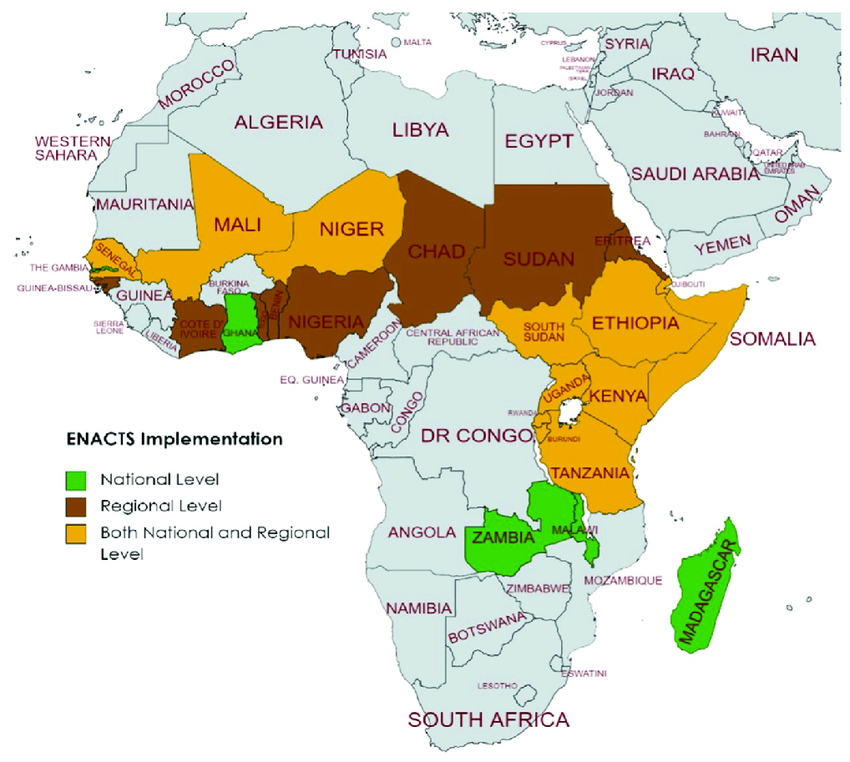
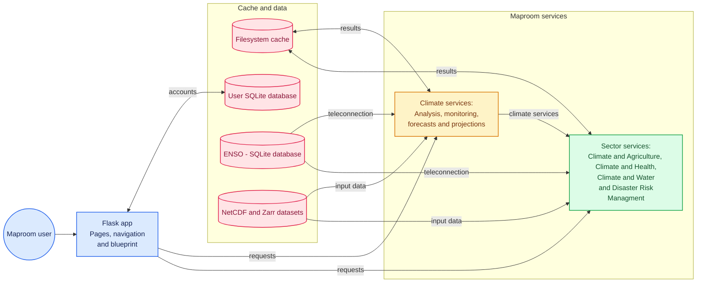
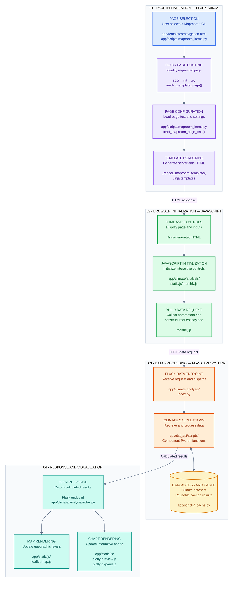

# 1. Overview

## 1.1. Introduction

Maprooms is a web application for exploring climate information through interactive maps and charts. It supports historical climate analysis, monitoring, forecasts, and future projections. It also provides products for climate-sensitive sectors, including agriculture, water, health, and disaster risk management (DRM).

Maprooms was created within the ENACTS initiative to help sector specialists and other end users access climate information, including high-resolution data. Many National Meteorological and Hydrological Services (NMHS) around the world have their own Maprooms. Regional Maprooms are also available, for example for the Sahel region.

Previously, Maprooms was developed by IRI using its own programming language, INGRID. Following IRI's shutdown, maintaining the INGRID-based implementation and updating the Maprooms became more difficult. Moving to Python provides a solution for continuing their development, maintenance, and improvement.

Working with large datasets can make accessing climate information challenging, particularly because different users need different types of information and analysis. In the new Maproom, backend functions perform climate calculations, while the frontend renders the results as maps and charts. Some calculations and processing tasks are shared between the server and the user's computer. This distribution of work helps improve speed and responsiveness, making climate information easier to access and explore.

For developers, the Python implementation provides a modular structure that connects calculation scripts, configuration files, Jinja templates, and JavaScript. This structure allows developers to adapt the Maproom to country-specific datasets and requirements, reuse existing functionality, and add products that respond to the needs of different sectors and users.


*Countries and regions where ENACTS has been implemented.*

## 1.2. Technical aspects of the new Maproom
### 1.2.1. Flask web application

The new Maproom is built in Python using the Flask web framework.

Flask provides a structure that makes the application easier to develop, update, and maintain. Installation scripts and supporting functions are already available to help developers prepare the environment and maintain the application.

The application framework has been developed specifically to support Maprooms for NMHS and Regional Climate Centres (RCC). Its modular organization makes it easier to add climate information services that address the requirements of a particular country, region, or sector.

Improving response speed compared with the earlier Maproom implementation is another important objective. Shared functions, prepared datasets, and cached results help the application deliver climate information efficiently.

The main application is initialized in `app/__init__.py`. This file loads the Flask configuration, registers the blueprints, initializes the cache, and prepares supporting database tables.

A blueprint groups related routes and resources. For example, the climate analysis blueprint provides calculation endpoints and static files used by several climate analysis pages. Multiple products can therefore share the same blueprint.

The following diagram summarizes the framework:



### 1.2.2. Datasets and configuration for a specific country


Country-specific information is maintained in configuration files. The main application keeps the same overall structure, while the configuration adapts it to the datasets, institutional information, languages, and products required by each implementation.

Language options, product descriptions, and text displayed alongside maps and charts can be adapted through these configuration files.

The main files are:

```text
config.py
app/yaml/datasets-config.yaml
app/yaml/nmhs-info.yaml
```

Their responsibilities are:

| File | Main purpose |
|---|---|
| config.py | Flask settings, application runtime data directory, and supported languages |
| app/yaml/datasets-config.yaml | Dataset identifiers, variable mappings, source paths, and processing settings |
| app/yaml/nmhs-info.yaml | Institution name, website, logos, initial map position, and related settings |

Other configuration files define geographic boundaries, basemaps, shared interface text, and page-specific controls.

The application runtime data directory and the climate dataset directories are configured separately:

- MAPROOMS_DATA_DIR in config.py specifies where the application stores cache, user files, and SQLite databases.
- Paths in datasets-config.yaml specify where climate datasets and supporting geographic data are located.

Many YAML files have a corresponding template with a dev- prefix. The application reads the active files without this prefix. Their preparation is described in [chapter 4](4-installation.md)


### 1.2.3. ENACTS datasets and supporting tools

Because the new Maproom uses a different framework, supporting tools have also been developed to handle ENACTS datasets in Python. These tools provide data-processing functionality previously handled through INGRID.

An important part of this workflow is converting NetCDF source files into Zarr stores. This makes long time series and spatial datasets easier to organize and access, including datasets with a resolution of approximately 4 km × 4 km.

For example, a country's climate datasets can exceed 50 GB when daily and dekadal rainfall and temperature data are included. Organizing these datasets in Zarr supports more flexible access for grid-point and regional analysis.

The dst_api tool is included as a Git submodule under app/dst_api/. It provides dataset access and many of the calculations used by Maprooms. Application scripts can call its Python functions directly.

The main supporting resources are:

    app/dst_api/
    convert2zarr.py
    computed2zarr.py
    climato2zarr.py

The preparation scripts have different responsibilities:

| Script | Main function called | Purpose |
|---|---|---|
| convert2zarr.py | create_zarr_datasets() | Convert configured source NetCDF datasets to Zarr |
| computed2zarr.py | create_computed_zarr_datasets() | Prepare supported derived datasets configured for Zarr output |
| climato2zarr.py | compute_some_climatogies() | Prepare supported climatological products |

Dataset preparation depends on the active configuration in app/yaml/datasets-config.yaml. [Section 4.2](4-installation.md#42-data-preparation) explains this workflow.


### 1.2.4. Backend and frontend technologies
#### 1.2.4.1. Python backend

The Maproom backend is primarily written in Python. Calculation functions are maintained in the scripts/ directories of the application and its components.

A typical component uses:

    app/<domain>/<component>/index.py
    app/<domain>/<component>/scripts/

The index.py file defines the component blueprint and its endpoints. The scripts/ directory contains calculation functions and supporting utilities.

For example, app/climate/analysis/index.py receives requests for climate analysis products and calls functions from the component's calculation scripts.

Components can also reuse functionality from:

    app/scripts/
    app/misc/scripts/
    app/dst_api/scripts/

This organization allows several products to share dataset access, statistical calculations, image generation, and caching functions.


#### 1.2.4.2. Jinja templates and JavaScript frontend

The frontend is primarily built with JavaScript and Jinja templates.

The main locations are:

    app/templates/
    app/static/js/
    app/<domain>/<component>/templates/
    app/<domain>/<component>/static/js/

Jinja templates define the HTML structure rendered by Flask. JavaScript initializes the controls, sends requests, and displays the returned results.

A product template, such as app/climate/analysis/templates/monthly.html, extends the shared app/templates/layout.html template. The shared layout loads common styles, browser libraries, navigation, and JavaScript utilities.

The main template blocks are:

| Block | Purpose |
|---|---|
| title | Define the browser page title |
| head | Extend the shared page header; super() preserves its existing content |
| content | Define the product's visible interface |
| javascript | Pass page settings to JavaScript and load page-specific scripts |

Reusable interface elements are defined through Jinja macros:

| File | Examples of functionality |
|---|---|
| app/templates/macros.html | Information cards, map containers, chart cards, and chart dialogs |
| app/templates/control-map-macros.html | Map-control inputs |
| app/templates/control-expand-macros.html | Expanded-chart controls |

For example, the monthly analysis template uses *create_card_information(), create_map_control(), create_card_charts()*, and *create_modal_expand_charts()*.

Flask passes configuration and application information to templates through variables such as:

- pageText: assembled page text and settings.
- metInfo: institutional information.
- dataInfo: dataset coverage and resolution information.
- urlArgs: identifiers for the current domain, component, and page.
- langUser: language information.
- dataUser: current user information.

The component's *block-js.html* exposes selected values to JavaScript. The page-specific script then initializes the map, controls, charts, and event handlers.

For example:

    app/climate/analysis/yaml/monthly.yaml
    app/climate/analysis/templates/monthly.html
    app/climate/analysis/templates/block-js.html
    app/climate/analysis/static/js/monthly.js

Leaflet displays maps and geographic overlays. Plotly displays interactive charts.

Jinja HTML templates and dev- YAML templates serve different purposes: HTML templates define the interface, while YAML templates provide starting configuration values.


## 1.3. Typical interaction with a Maproom


A typical interaction begins when a user opens a product page. Flask renders the initial interface, and JavaScript subsequently requests the data needed for maps and charts.

For example, the monthly climate analysis page is identified by:

    /maproom_pages?maproom=climate&component=analysis&page=monthly

The generic page-rendering and data-request sequence is shown below:




The principal functions in this sequence are:

| Function | Location | Responsibility |
|---|---|---|
| *render_template_page()* | *app/\__init__.py* | Assemble the navigation and page context, then request template rendering |
| *load_maproom_page_text()* | *app/scripts/maproom_items.py* | Combine shared and page-specific YAML settings |
|*parse_lang_yaml_nested()* | *app/scripts/maproom_items.py* | Select language-specific values from configuration dictionaries |
| *__render_maproom_template()** | *app/\__init__.py* | Locate the page template, incorporate the local *block-js.html* where applicable, and render the result |
| *data_info_coverage()** | *app/scripts/maproom_items.py* | Prepare dataset coverage and resolution information for the interface |
| *cache_data_functions()** | *app/scripts/_cache.py* | Reuse a cached calculation result or calculate and store a new result |


On the monthly analysis page, JavaScript functions such as *createLeafletTileLayer(), setOffCanvasMapControl(), and displayClimateAnalysisMap()* initialize the map and its controls.

The browser sends JSON parameters to calculation endpoints such as */climate_analysis_map*. The endpoint calls Python functions and returns a JSON response. For climate analysis maps, this response can contain a generated image overlay and associated metadata; chart responses contain the values needed for plotting.

Changing a date, variable, location, or region can trigger another request. Where the relevant calculation uses caching, an existing result may be reused.
