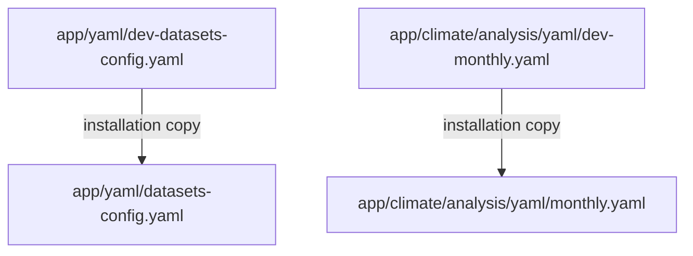
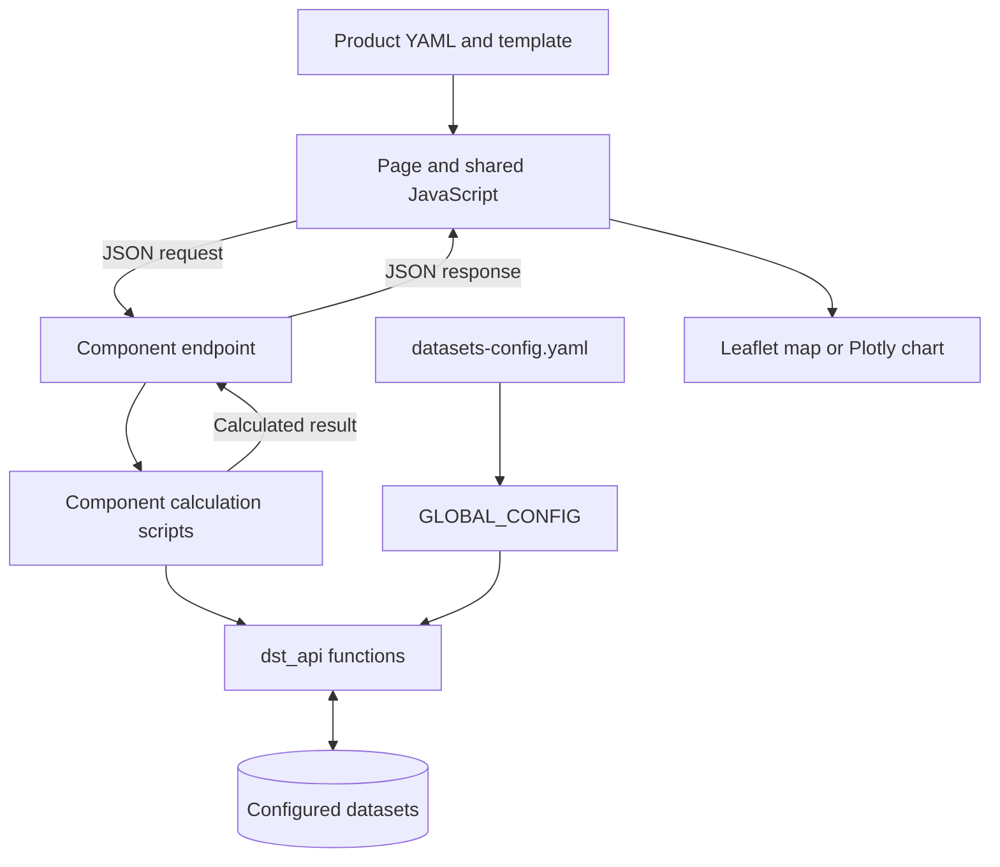

# 5. Maproom Structure

## 5.1. Architecture overview

The Maproom application is organized into shared application resources, domain-specific components, configuration files, and supporting scripts.

Shared resources provide functionality used across several products. Domain and component directories organize the pages, controls, routes, and calculations associated with a particular climate service or sector.

The following tree presents the main application structure. Braces provide a compact description of a directory's contents. Additional files, including package initialization files, are omitted from some directories for readability.

```text

maprooms/
├── .gitignore
├── .gitmodules
├── app/
│   ├── __init__.py
│   ├── templates/
│   ├── static/
│   │   ├── css/
│   │   ├── images/
│   │   ├── js/
│   │   ├── lang/
│   │   └── libs/
│   ├── yaml/
│   ├── scripts/
│   ├── auth/{index.py,scripts/,templates/,static/,yaml/}
│   ├── admin/{index.py,scripts/,templates/,static/,yaml/}
│   ├── dst_api/{index.py,scripts/}
│   ├── misc/{index.py,scripts/,static/}
│   ├── climate/
│   │   ├── yaml/
│   │   ├── analysis/{index.py,scripts/,templates/,static/,yaml/}
│   │   ├── monitoring/{index.py,scripts/,templates/,static/,yaml/}
│   │   ├── forecast/{index.py,scripts/,templates/,static/,yaml/}
│   │   └── projection/{index.py,scripts/,templates/,static/,yaml/}
│   ├── agriculture/
│   │   ├── yaml/
│   │   └── analysis/{index.py,scripts/,templates/,static/,yaml/}
│   ├── health/
│   │   ├── yaml/
│   │   └── malaria/{index.py,scripts/,templates/,static/,yaml/}
│   ├── drm/
│   │   ├── yaml/
│   │   ├── analysis/{index.py,scripts/,templates/,static/,yaml/}
│   │   ├── monitoring/{index.py,scripts/,templates/,static/,yaml/}
│   │   └── anticipation/{index.py,scripts/,templates/,static/,yaml/}
│   └── water/
│       ├── yaml/
│       ├── analysis/{index.py,scripts/,templates/,static/,yaml/}
│       ├── monitoring/{index.py,scripts/,templates/,static/,yaml/}
│       ├── forecast/{index.py,scripts/,templates/,static/,yaml/}
│       └── projection/{index.py,scripts/,templates/,static/,yaml/}
├── scripts/
│   └── copy-vendor-assets.js
├── config.py
├── run.py
├── setup.py
├── requirements.txt
├── package.json
├── package-lock.json
├── LICENSE
├── clearCache.py
├── climato2zarr.py
├── computed2zarr.py
├── convert2zarr.py
├── convertCMIP6tozarr.py
├── computeMONSPEIpars.py
├── getGygaAfTAW.py
├── initRainySeason.py
├── updateENSO-monthly.py
├── updateENSO-oni.py
├── updateENSO-probabilities.py
└── updateENSO-weekly.py
```

Runtime data and climate datasets can be stored outside this source directory. Their locations are defined through *config.py* and *app/yaml/datasets-config.yaml*, as described in chapter 4.


###    5.1.1. Repository tree and top-level files

The top level of the repository contains files used to start the application, define its configuration and dependencies, and prepare supporting datasets.

The main files include:

      run.py
      config.py
      setup.py
      Data-preparation scripts

Their responsibilities are summarized below:

| File or resource | Main responsibility |
|---|---|
| run.py | Start the local Flask development server |
| config.py | Define Flask settings, the runtime data directory, and supported languages |
| setup.py | Define Python package metadata and installation requirements |
| requirements.txt | List the required Python packages |
| package.json | Define browser dependencies and frontend build commands |
| package-lock.json | Record the resolved npm dependency versions |
| scripts/copy-vendor-assets.js | Prepare browser libraries under app/static/libs/ |
| convert2zarr.py | Convert configured source NetCDF datasets to Zarr |
| computed2zarr.py | Prepare supported derived datasets configured for Zarr output |
| climato2zarr.py | Prepare supported climatological products |
| convertCMIP6tozarr.py | Prepare CMIP6 climate projection data as Zarr |
| computeMONSPEIpars.py | Prepare configured SPI and SPEI distribution parameters |
| getGygaAfTAW.py | Retrieve supporting GYGA soil water-capacity data |
| initRainySeason.py | Initialize supported rainy-season calculations |
| updateENSO-*.py | Update the corresponding climate indices or ENSO information |
| clearCache.py | Clear the configured application calculation cache |
| .gitmodules | Declare the dst_api Git submodule |
| .gitignore | Define exclusions for local configuration and other files |
| LICENSE | State the source-code licensing terms |

These supporting scripts are entry points to functions maintained inside the application packages. For example, *convert2zarr.py* calls *create_zarr_datasets()* from *app/dst_api/scripts/zarrdata.py*.

The top-level **scripts/** directory contains frontend preparation utilities. Shared application Python functions are located separately in **app/scripts/**.


###   5.1.2. Flask package layout
####        5.1.2.1. Shared application resources

The main Flask application contains shared *templates/*, *static/*, *scripts/*, and *yaml/* directories. These hold resources used by several domains and products.

      app/templates/
      app/static/
      app/scripts/
      app/yaml/

The *app/yaml/* directory contains shared configuration files. Many active files have a corresponding template beginning with *dev-*.

      For example:

      app/yaml/dev-example.yaml
      app/yaml/example.yaml

Only the active file without the dev- prefix is read during normal application use.

Shared YAML files define institutional information, dataset access, navigation, language-dependent text, map layers, color settings, reference periods, and other common options.

The **app/templates/** directory contains the shared Jinja templates used to render the application. These include the main layout, navigation, information cards, layer controls, map controls, and expanded-chart controls.

      Important examples are:

      app/templates/layout.html
      app/templates/navigation.html
      app/templates/macros.html
      app/templates/control-map-macros.html
      app/templates/control-expand-macros.html
      app/templates/layers.html

The **app/static/** directory contains resources sent to the browser:

| Directory | Contents |
|---|---|
| css/ | Shared page, map, and interface styles |
| images/ | Logos, icons, and other images |
| js/ | Shared JavaScript functions |
| lang/ | Browser-library language resources |
| libs/ | Prepared third-party browser libraries |

The **app/static/js/** directory provides functions for Leaflet maps, colors, map controls, date navigation, chart previews, expanded charts, and downloads.

The **app/scripts/** directory contains shared Python functions. Examples include configuration loading, navigation preparation, caching, geographic processing, color handling, and image generation.

A product can therefore reuse existing resources instead of implementing the same functionality again.


####      5.1.2.2. Domain and component directories

Maprooms organizes climate services and climate-sensitive sector products into domains, including:

      app/climate/
      app/agriculture/
      app/health/
      app/drm/
      app/water/

A domain can contain several components. For example, the climate domain contains analysis, monitoring, forecast, and projection components.

A product page is then maintained within the relevant component:

      app/climate/analysis/templates/monthly.html

In this example:

- climate is the domain.
- analysis is the component.
- monthly is the product page.

A component generally follows this organization:
```text
app/<domain>/<component>/
├── __init__.py
├── index.py
├── templates/
├── static/
│   └── js/
├── yaml/
└── scripts/
```
The directories have complementary roles:

| Resource | Purpose |
|---|---|
| index.py | Define the blueprint, routes, and connections to calculation functions |
| templates/ | Define the component's product interfaces |
| static/ | Hold component-specific browser resources |
| yaml/ | Define navigation, product descriptions, datasets, and control options |
| scripts/ | Provide component-specific Python calculations and utilities |

The local **scripts/** directory is needed when the component has its own calculations. A component can also import suitable functions from another component or a shared package.

Several products can share one blueprint. For example, daily, dekadal, and monthly climate analysis pages use the climate analysis component and its calculation endpoints.

Developers can add products or components to meet country-specific or sector-specific needs while following this organization.

The application also contains:

      app/auth/
      app/admin/

These packages define blueprints for authentication, user-related functions, and administration.

Supporting packages include:

- app/misc/, which provides shared supporting endpoints and calculations.
- app/dst_api/, which provides dataset access, extraction, and climate calculations.

The folders required by a package depend on its responsibilities. Supporting packages do not necessarily need the same template and static structure as a product component.


###   5.1.3. Route groups and blueprints

The project uses *__init__.py* files to organize Python packages and define package initialization where required.

Many component and calculation-package initialization files are empty. Their presence supports the package organization used by the project.

However, *app/__init__.py* is not the only initialization file that can contain code. For example, *app/dst_api/scripts/__init__.py* imports and exposes functions from several calculation modules.

The main *app/__init__.py* file has a central role: it creates the Flask application, loads its configuration, imports and registers blueprints, initializes supporting services, and defines shared page routes.

The main resources are:

      app/__init__.py
      Component index.py files

Each component's index.py defines its blueprint and the routes associated with that component.

For example, *app/climate/analysis/index.py* declares:
```python
climate_analysis = Blueprint(
    'climate_analysis',
    __name__,
    template_folder='templates',
    static_folder='static',
    static_url_path='/static/climate_analysis',
)
```

The blueprint identifies the component's templates, static resources, and endpoints.

Its connection to the main application is established in *app/__init__.py* through an import and registration:

```python
from app.climate.analysis.index import climate_analysis

app.register_blueprint(climate_analysis)

```
The main application therefore connects directly to component blueprints through *app/__init__.py*.

There are two important groups of routes:

| Route group | Examples | Responsibility |
|---|---|---|
| Shared page and navigation routes | /, /maproom_items, /maproom_pages | Display navigation and render product pages |
| Component calculation routes | /climate_analysis_map, /climate_analysis_rawdata | Receive parameters and return calculated results |


This separation allows several product pages to use the same component endpoints.


###    5.1.4. Configuration hierarchy

Maproom configuration is assembled through several connected resources:

      config.py
      app/scripts/_global.py
      app/scripts/maproom_items.py
      Shared and component YAML files

Each resource has a different responsibility.

**Application configuration**

The main application loads *config.py* through:

```python
app.config.from_object('config')
```

This file contains Flask settings and local application values, including **MAPROOMS_DATA_DIR** and the supported languages.

Shared runtime configuration

The *app/scripts/_global.py* module creates the **GLOBAL_CONFIG** dictionary.

It reads local settings from *config.py*, loads institutional and dataset configuration, defines runtime paths, and prepares shared language and navigation information.

For example, it loads:

      app/yaml/nmhs-info.yaml
      app/yaml/datasets-config.yaml

Component scripts can then access the relevant settings through GLOBAL_CONFIG.

**Navigation configuration**

Navigation entries are defined through *maproom_items.yaml* files at the application, domain, and component levels.

For example:

      app/yaml/maproom_items.yaml
      app/climate/yaml/maproom_items.yaml
      app/climate/analysis/yaml/maproom_items.yaml

These files describe navigation titles, descriptions, cards, icons, components, and product-page entries.

Functions in *_global.py* and *maproom_items.py* use these entries to construct navigation information and page links.

**Page configuration**

The *load_maproom_page_text()* function in *app/scripts/maproom_items.py* combines shared settings with the YAML file for the selected product.

For the monthly climate analysis page, the product-specific file is:

      app/climate/analysis/yaml/monthly.yaml

The assembled result is passed to the template as **pageText**.

Relevant functions include:

| Function | Responsibility |
|---|---|
| get_navigation_items() | Build shared navigation metadata from active navigation files |
| set_navbar_path() | Build the navigation path from domain, component, and page identifiers |
| load_maproom_items() | Prepare navigation-card or product-list content |
| load_navigation_items() | Prepare navigation information for the current location |
| load_maproom_page_text() | Assemble shared and product-specific page settings |
| parse_lang_yaml_nested() | Resolve language-specific configuration values |

The order of configuration loading matters. Product settings are merged after many shared settings, while additional instructions and JavaScript text are added later.

These updates operate on dictionary keys. Replacing a top-level configuration key can replace the associated group of settings, so inspect the loader before overriding a complete section.

**Configuration refresh**

The *load_yaml_file()* helper in *app/scripts/util.py* caches parsed YAML and checks file metadata to detect changes when a file is requested again.

Some values, however, are assembled into **GLOBAL_CONFIG** when its module is imported. Restart the application after changing startup configuration, dataset paths, or navigation that was initialized at startup.


###    5.1.5. The role of dev- files

The dev- files provide shared configuration templates for installation and development.

They are found in both shared and component YAML directories:
```html
app/yaml/dev-*.yaml
app/<domain>/<component>/yaml/dev-*.yaml
```
For example:



The template provides starting values. The active file without the prefix contains the configuration used by the local application.

This distinction allows developers to share configuration templates while maintaining local dataset paths, institutional information, and other implementation-specific settings.

The application's .gitignore contains these YAML rules:

```yaml
*.yaml
!dev-*.yaml
```

These rules generally exclude active local YAML files while allowing the dev- templates to be included in version control. Files already tracked by Git remain tracked unless handled separately.

The *.gitignore* also excludes local files such as *config.py* and *run.py*, along with other generated or installation-specific resources.

When maintaining configuration:

- Update the active file to change the local implementation.
- Update the corresponding dev- template when a change should be shared through the [development workflow](9-maintain.md#91-git-process).
- Review template changes before applying them to an existing local configuration.
- Preserve country-specific values when installation or update scripts copy templates.

Editing a dev- template alone does not change the active file read by the application.


## 5.2. Interconnection between application components

The application directories work together to provide each product. A product page connects its YAML configuration, Jinja template, JavaScript, calculation endpoints, and Python functions to shared application resources.

The monthly climate analysis page provides a practical example of these connections.

### 5.2.1. Module templates and the shared application layout

The monthly analysis page uses:

      app/climate/analysis/templates/monthly.html
      app/templates/layout.html

The component template defines the product-specific content and extends the shared layout:

```html

```

The shared layout loads common styles, browser libraries, navigation, and JavaScript functions. The product template fills its page blocks, including title, head, content, and javascript.

When extending the head block, super() preserves the content supplied by the shared layout.

Reusable Jinja macros provide information cards, map controls, chart cards, and expanded-chart dialogs.

For example, the monthly page calls:

```html
{{ fmacros.create_card_information(
    pageText.description,
    pageText.instruction
) }}
```
The shared layout imports the macro collections used by the component templates:

      macros.html                 → fmacros
      control-map-macros.html     → fmacrosMap
      control-expand-macros.html  → fmacrosExp

The *render_template_page()* function assembles the page context. The *_render_maproom_template()* function then locates the selected template in the component directory, with a domain-level fallback supported by the renderer.

It also incorporates the component's local block-js.html where the recognized include is present.

For monthly analysis:

      app/climate/analysis/templates/block-js.html

This file exposes selected context values to JavaScript, including institutional information, dataset coverage, language settings, map layers, and URL arguments.

The product template also passes page-specific values such as the selected dataset and default thresholds.

### 5.2.2. Module static files and shared JavaScript

The monthly analysis page uses:

      app/climate/analysis/static/js/monthly.js
      app/static/js/

The component's JavaScript defines how the product initializes and responds to user actions. Shared JavaScript provides reusable map, chart, control, and request functions.

The template loads the component script through the blueprint's static endpoint:

```html
<script
    src="{{ url_for('climate_analysis.static', filename='js/monthly.js') }}">
</script>
```

The shared layout loads the common JavaScript before the product's JavaScript block.

The monthly page therefore calls shared functions that are already available in the browser:

| Function | Shared file | Responsibility |
|---|---|---|
| createLeafletTileLayer() | leaflet-map.js | Create the Leaflet map and its base layers |
| setOffCanvasMapControl() | map-offcanvas-ctrl.js | Initialize the map-control interface |
| displayClimateAnalysisMap() | leaflet-map-settings.js | Build the map request and initiate its display |
| mapClickLayersSpatialAverage() | leaflet-map.js | Connect geographic selection to chart updates |
| preview_analysis_display_charts() | plotly-preview.js | Update the analysis chart previews |

The page script also connects date navigation, redraw buttons, region selection, and expanded-chart buttons to the appropriate functions.

The shared *createEndpoint()* function in *app/static/js/maprooms.js* uses the Flask URL helper exposed by JSGlue to resolve blueprint endpoint names.

For example, *displayClimateAnalysisMap()* requests the endpoint identified by:

      climate_analysis.climate_analysis_map

Keeping common behavior in shared files allows several products to use the same controls and rendering functions.

### 5.2.3. Blueprint routes and Python scripts

The climate analysis component connects browser requests to Python calculations through:

      app/climate/analysis/index.py
      app/climate/analysis/scripts/

The *index.py* file receives the request, reads its parameters, calls a calculation function, and returns the result.

For example, the existing map endpoint is:

```python
@climate_analysis.route('/climate_analysis_map', methods=['POST'])
def climate_analysis_map():
    params = request.get_json()
    try:
        map_data = climate_analysis_sp_data(params)
        return json.dumps(map_data)
    except Exception as e:
        return json.dumps({'status': -1, 'message': str(e)})
```

The calculation function is imported from the component's spatial analysis script:

```python
from .scripts.analysis_sp import climate_analysis_sp_data
```

This function obtains the requested climate data and prepares the map image and associated information.

Time-series calculations are maintained separately in:

      app/climate/analysis/scripts/analysis_ts.py

For example, the raw-data chart endpoint calls *climate_analysis_ts_rawdata()* through the shared *cache_data_functions()* helper.

This separates the responsibilities:

- The route handles communication with the browser.
- The calculation script processes the requested information.
- Shared utilities provide dataset access, statistical methods, caching, or image generation.

Where a route uses caching, the cache helper can return a previously calculated result. Otherwise, it calls the calculation function and stores a successful result for reuse.

Not every endpoint uses the same cache wrapper; follow the existing implementation for the relevant calculation.


### 5.2.4. Component blueprints and the main application

Component blueprints become part of the application through imports and registration in:

      app/__init__.py

For example:

```python
from app.climate.analysis.index import climate_analysis

app.register_blueprint(climate_analysis)
```

The import makes the blueprint object available to the main application. Registration connects its routes and static endpoint to the Flask application.

Creating a component directory does not automatically register a blueprint. A new blueprint must be connected explicitly to the main application.

A new page within an existing component can reuse that component's registered blueprint. It does not necessarily require another blueprint.

Page navigation is configured separately through maproom_items.yaml. Blueprint registration makes endpoints available, while navigation configuration makes the intended product accessible through the Maproom interface.

For a working product, verify that its navigation entry, page identifiers, YAML file, template, JavaScript, and required calculation endpoints are connected consistently.

[Chapter 6](6-module.md) describes how to create and register a module.

### 5.2.5. Datasets and the Maproom

Dataset access connects the active configuration, shared runtime settings, and calculation functions:

      app/yaml/datasets-config.yaml
      app/scripts/_global.py
      app/dst_api/scripts/

The *datasets-config.yaml* file defines the available datasets, variable mappings, source locations, Zarr locations, and supporting data settings.

The *_global.py* module loads this configuration into **GLOBAL_CONFIG**. Calculation functions then use these settings to locate and process the requested data.

A product selects the relevant dataset through its own configuration. For example, the monthly climate analysis page includes:

```yaml
dataset:
    use: ALL
    variables:
        precip: [precip]
        tmax: [tmax]
        tmin: [tmin]
```

The page passes this selection to JavaScript, which builds requests containing identifiers such as the dataset, variable, temporal resolution, date, and selected geographic area.

The component's Python scripts call functions from dst_api to read or extract the required data and perform the supported calculations.

dst_api is included as a Git submodule under *app/dst_api/*. Its Python functions can be imported directly by the application; the component does not need to make an HTTP request to a separate service for these direct calls.

The application also prepares dataset information for the interface:

- *get_datasets_information()* reads information about configured datasets.
- *data_info_coverage()* selects coverage and resolution information used by the pages.
- This information is passed through the template context and exposed to JavaScript where needed.

Dataset identifiers and variable names must remain consistent between the shared configuration, product YAML, JavaScript requests, and Python calculations.

The main calculation connection can be summarized as follows:



Adding a dataset path alone does not create a new product. The dataset must be prepared where required, selected by the product configuration, and supported by its calculation functions.

