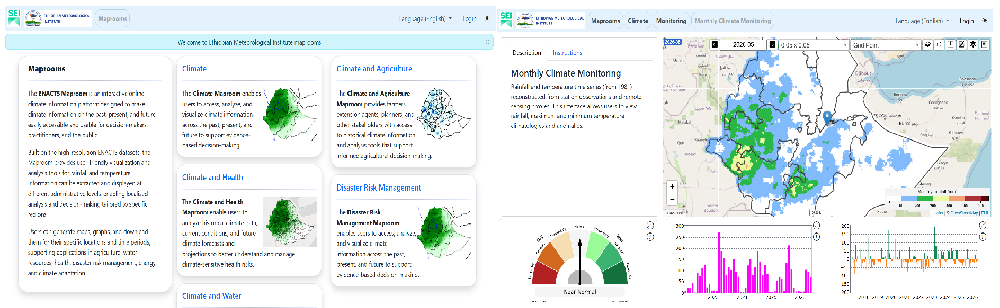
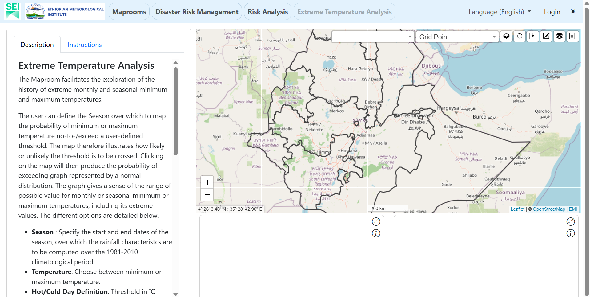

# 6. Create and Register a Module

This chapter explains how to create the initial structure of a Maproom product page, configure its navigation, and connect it to the application.

The expected initial result is the empty placeholder shown in [section 6.4](#64-test-the-initial-rendering):

- Navigation identifying the selected product.
- A description and instructions panel on the left.
- A basemap with shared controls on the right.
- Two empty chart cards below the map.

The chapter retains examples from the Climate and DRM domains to illustrate the existing development process.

The placeholder example uses the existing DRM analysis component:

       app/drm/analysis/

A new page named placeholder is used for the initial rendering. Its displayed title is Extreme Temperature Analysis, following the [reference figure](#64-test-the-initial-rendering).

Using a separate page identifier preserves the existing ext_temperature product while allowing developers to follow the same page-building process.

This chapter assumes that Maprooms is already installed and that its shared configuration, datasets, browser libraries, and geographic boundaries are working as described in [chapter 4](4-installation.md).


##  6.1. Create module page navigation
###   6.1.1. Configure navigation-card entries

The *maproom_items.yaml* files describe navigation content and determine whether a navigation level displays categories or individual products.

These files are maintained at the application, domain, and component levels. Each relevant directory has its own *yaml/* directory containing the navigation configuration.

For the DRM example, the hierarchy is:

       app/yaml/maproom_items.yaml
           ↓
       app/drm/yaml/maproom_items.yaml
           ↓
       app/drm/analysis/yaml/maproom_items.yaml

The type setting distinguishes the two navigation structures:

| Setting | Purpose |
|---|---|
| navigation-card | Organize navigation around child domains or components |
| navigation-page | List individual product pages |



       app/yaml/maproom_items.yaml
       app/climate/yaml/maproom_items.yaml

A navigation-card configuration identifies its child directories through components.

For example, the DRM domain includes an analysis component:

```yaml
type: navigation-card

components:
    - analysis
```

The following Climate example illustrates the relationship between the description, navigation type, image, and component list:

```yaml
...
        <p>
        Enfin, les produits de <strong>Prévision et de Projection Climatiques</strong> donnent accès aux prévisions climatiques saisonnières ainsi qu’aux projections à long terme du changement climatique. Ils aident ainsi les utilisateurs à anticiper les conditions futures et à planifier leurs actions en conséquence.
        </p>
type: navigation-card
# icon_image from /app/static/images/card_icons
icon_image: default-emi_climate.gif

components:
    - analysis
    - monitoring
    - forecast
    - projection
...

```

The components list identifies the child directories displayed at that navigation level. Each child provides its own navigation title, description, and optional icon through its corresponding maproom_items.yaml.

Use this structure when creating or extending a category. When adding a product to an existing component, the main change is usually made in that component's navigation-page configuration.


###    6.1.2. Configure navigation-page entries

A navigation-page configuration lists individual products under maprooms.

For the DRM analysis component, the active file is:

       app/drm/analysis/yaml/maproom_items.yaml

The following example comes from the Climate analysis component and illustrates the same configuration pattern:

       app/climate/analysis/yaml/maproom_items.yaml

```yaml
...
type: navigation-page
icon_function: icon_monthly_analysis
maprooms:
    - daily:
        title:
            en: Daily Climate Analysis
            fr: Analyse Climatique Journalières
        description:
            en: The Maproom explores historical daily precipitation and temperatures by calculating simple seasonal statistics and the history of extreme.
            fr: Le Maproom explore les précipitations et températures journalières en calculant de simple statistiques saisonniers et des extrêmes historiques.
        icon_function: icon_daily_analysis
    - dekadal:
        title:
            en: Dekad Climate Analysis
            fr: Analyse Climatique Décadaire
        description:
            en: This interface allows users to view rainfall, maximum, minimum and mean temperature dekadal climatologies and seasonal anomalies.
            fr: Cette interface permet à l'utilisateur de visualiser les climatologies décadaires et les anomalies saisonnières de précipitations et des températures.
        icon_function: icon_dekadal_analysis
    - monthly:
        title:
            en: Monthly Climate Analysis
            fr: Analyse Climatique Mensuelle
...
```

       app/climate/analysis/yaml/maproom_items.yaml


Each key under maprooms, such as daily, dekadal, or monthly, identifies a product page.

That identifier must match the relevant HTML template and active page YAML file. For example:

       monthly
           → templates/monthly.html
           → yaml/monthly.yaml

The navigation title appears in the interface, while the description is used in the product's navigation entry.

For the DRM placeholder example, add an entry under the existing maprooms list in app/drm/analysis/yaml/maproom_items.yaml:

```yaml
    - placeholder:
        title:
            en: Extreme Temperature Analysis
            fr: Analyse des températures extrêmes
        description:
            en: Explore historical extreme minimum and maximum temperatures.
            fr: Explorer les températures minimales et maximales extrêmes historiques.
        icon_image: default-emi_exttemp.gif
```

Preserve the other product entries.

Maintain the corresponding shared configuration template as appropriate:

       app/drm/analysis/yaml/dev-maproom_items.yaml

The running application reads the active file without the dev- prefix.


###    6.1.3. Create or select an icon
####       6.1.3.1. Generate an icon through a Python function

Navigation icons can be generated from climate data through a Python function.

The navigation configuration references the function through icon_function. The function is maintained in the relevant component's scripts/icons.py file.

For example:

       app/climate/analysis/scripts/icons.py

This approach can produce an icon representing a sample dataset, map, or calculation associated with the component.

Both category cards and product entries can use a generated icon where supported by the navigation loader.


####       6.1.3.2. Use an existing image

An existing image can also be used through the icon_image setting.

The image location depends on the navigation entry:

       app/static/images/card_icons/
       app/climate/analysis/static/images/

Images for category cards are read from the shared *card_icons/* directory. Images for individual products are read from the relevant component's *static/images/* directory.

The same image can be reused for several entries, provided it is available in the location expected by each entry.

For the DRM placeholder, the existing image is:

       app/drm/analysis/static/images/default-emi_exttemp.gif

Its configuration is:

       icon_image: default-emi_exttemp.gif


####        6.1.3.3. Make an icon function available to the loader

The following example shows how an icon can be generated from sample climate data.

The function belongs to the component's scripts/icons.py file. For example:

app/climate/monitoring/scripts/icons.py

It retrieves sample data, applies a color scale, adds geographic boundaries, and returns an encoded image for display in the navigation card.


```python
...
def icon_climate_monitoring():
    from app.scripts._cache import cache
    from app.dst_api.scripts import read_shapefiles
    from app.scripts.colorbar import get_ColorBarName
    from app.scripts.icons import create_icon_data
    from app.dst_api.scripts import download_analysis

    cached_data = cache.get('icon_climate_monitoring')
    if cached_data is None:
        map_colors = get_ColorBarName('BrBG', 20, True)

        params = {'analysis': 'anomaly', 'anomaly': 'standardized', 'dataset': 'ALL', 'temporalRes': 'monthly',
                  'variable': 'precip', 'geomExtract': 'original', 'outFormat': 'JSON-Format',
                  'startYear': '1991', 'endYear': '2020', 'minYear': 30, 'Date': '2023-07',
                  'gridded': True, 'webApp': True, 'finalOutput': False, 'climFunction': 'mean-stdev',
                  'fullYear': True, 'outFormat_0': 'JSON-Format', 'climDate': None, 'httpMethod': 'POST'}
        data = download_analysis(params)
        data = parse_json_spatial_data(data, 'Date')

        shapefile = _get_layers_shapefiles()
        gdf = read_shapefiles(shapefile)
        if gdf['status'] == -1:
            print(gdf['message'])

        cached_data = create_icon_data(data,
                                colors=map_colors['colors'],
                                colors_ext=map_colors['ext'],
                                gdf_boundaries=gdf['shp'])
        cache.set('icon_climate_monitoring', cached_data)
    return cached_data

```

This excerpt uses *parse_json_spatial_data()* and *_get_layers_shapefiles()*, which are available through the imports and helper definitions in the original module.

The sample dataset, date, variable, and boundary settings must match the available local data.

The cache allows the generated icon to be reused rather than recalculated every time its navigation entry is loaded.

The icon function must also be available through:

       app/scripts/icons.py

For example, the shared icon module already imports the monitoring icon functions:

```python
from app.climate.monitoring.scripts.icons import *
```

The navigation configuration can then refer to the function by name:

```yaml
       icon_function: icon_climate_monitoring
```

The name must match the available Python function.

The placeholder can use an existing image while retaining this generated-icon approach for subsequent product development.

##  6.2. Create the module structure

A new module or product page should follow the application architecture described in [chapter 5](5-maproom-structure.md#51-architecture-overview).

For example, a product requested by users can be added to an existing component when it belongs to the same category of service. A separate component can be created when the functionality requires its own grouping and blueprint.


###     6.2.1. Choose the domain and component directory

Distinguish between a category and a product when choosing where to place new functionality.

A category groups related products. A product provides a particular interface or analysis.

For example:

       app/climate/analysis/

contains related climate analysis products.

The placeholder example in this chapter uses:

       app/drm/analysis/

Its principal page resources are:

       templates/placeholder.html
       static/js/placeholder.js
       yaml/dev-placeholder.yaml
       yaml/placeholder.yaml

The component's existing *index.py*, *templates/block-js.html*, and navigation files provide the surrounding application connections.

When creating a separate component, follow the package and blueprint organization described in [chapter 5](5-maproom-structure.md#51-architecture-overview).


###     6.2.2. Create the HTML placeholder

Start by creating an HTML template for the product.

The application already provides shared structures and functions that developers can reuse through Jinja templates and macros.

The following namespaces are imported in *app/templates/layout.html*:

```html



```
The macro libraries are:

| Namespace | Source file | Purpose | When to use |
|---|---|---|---|
| fmacros | app/templates/macros.html | Shared cards, toolbars, chart containers, and dialogs. | Building the common page structure. |
| fmacrosMap | app/templates/control-map-macros.html | Map data-selection controls. | Selecting map variables, dates, statistics, and parameters. |
| fmacrosExp | app/templates/control-expand-macros.html | Expanded chart controls. | Adding settings inside an expanded chart modal. |


**Define the shared layout and page header**

Begin the template with:

```html


 {{metInfo.pageTitle}} 

{{ super() }}
<style>
    .card-description {
        height: 90vh;
    }
    .card-description-tab {
        max-height: 78vh;
    }
</style>


```

The extends statement reuses the shared application layout.

The title block defines the browser page title. The head block preserves the shared header through super() and adds the page-specific styles.

Styles can also be maintained in an appropriate CSS file. The inline styles above keep the initial example together.

**Define the page content**

Add the content block:

```html


<!--  -->
<div class="container-fluid" id="container-page">
    <div class="row">
        <div class="col-sm-4">
            {{ fmacros.create_card_information(pageText.description, pageText.instruction) }}
        </div>
        <div class="col-sm-8">
            <div class="row">
                <div class="col-sm-12 col-map-container">
                    <div id="div-map-container" class="div-map-container">
                        
                        
                    </div>
                </div>
            </div>
            <div class="row justify-content-center">
                <div class="col-sm-6">
                    {{ fmacros.create_card_charts("div-chart-cdf", pageText) }}
                </div>
                <div class="col-sm-6">
                    {{ fmacros.create_card_charts("div-chart-pdf", pageText) }}
                </div>
            </div>
        </div>
    </div>
    {{ fmacros.create_modal_matplotlib(pageText) }}
</div>


```

This block uses existing macros to build the page.

***create_card_information()*** places the description and instructions on the left, as shown in the [final figure](#64-test-the-initial-rendering).

The HTML div elements and Bootstrap column classes organize the remaining content:

- col-sm-4 contains the information panel.
- col-sm-8 contains the map and chart cards.
- Two col-sm-6 columns place the chart cards beside each other.

***create_map_control()*** provides the shared map-control structure. Its caller block is empty at this stage because product-specific control inputs have not yet been added.

***create_card_charts()*** creates the two chart containers. Their identifiers are kept separate:

       div-chart-cdf
       div-chart-pdf

The names reserve locations for the future charts; creating the containers does not plot any values.

***create_modal_matplotlib()*** adds the map-image dialog structure. Its calculation and display behavior can be connected during subsequent development.

The ***fmacrosExp*** namespace provides the expanded-chart controls used when the product's charts are developed. The initial placeholder keeps the chart cards empty.

**Pass settings to JavaScript and load the page script**

Page-specific variables can be declared in the template, while shared variables are supplied through the component's *block-js.html*.

The existing Extreme Temperature Analysis template provides the following example:

```html



<script>
const PARAMS_LIST = JSON.parse('{{ pageText.parameters | tojson }}');
// PARAMS_LIST.tmin = PARAMS_LIST.temperature;
// PARAMS_LIST.tmax = PARAMS_LIST.temperature;
const PARAMS_ORDER = JSON.parse('{{ pageText.parameters_order | tojson }}');
// const PARAMS_DEF = JSON.parse('{{ pageText.definition | tojson }}');
const PROBA_PLOT = JSON.parse('{{ pageText.opt_js_data | tojson }}');
</script>
<script type="text/javascript" src="{{ url_for('drm_analysis.static', filename='js/ext_temperature.js') }}"></script>


```

This example belongs to the existing ext_temperature product. It illustrates how product-specific configuration is exposed to JavaScript.

The active declarations require the corresponding YAML values:

       parameters
       parameters_order
       opt_js_data

The commented lines retain examples of additional assignments or configuration that can be enabled when required by the product.

For the new placeholder page, use the following simpler JavaScript block with the header and content blocks above:

```html

    

    <script
        type="text/javascript"
        src="{{ url_for('drm_analysis.static', filename='js/placeholder.js') }}">
    </script>

```

Use one javascript block in the page template. The longer block documents the existing product; the shorter block loads the placeholder script.

The component's existing file:

       app/drm/analysis/templates/block-js.html

supplies shared values such as MTO_INIT, LANG_USER, LAYERS, and DATA_SET.


###     6.2.3. Create the JavaScript placeholder

Each product can maintain its own JavaScript file: 

       static/js/<page>.js

An existing example is:

       app/climate/analysis/static/js/monthly.js

For the placeholder, create:

       app/drm/analysis/static/js/placeholder.js

The minimum initialization follows your existing example:

```js
$(document).ready(function() {
    // $('[data-bs-toggle="tooltip"]').tooltip();
    const tTriggerList = document.querySelectorAll('[data-bs-toggle="tooltip"]');
    const tooltipList = [...tTriggerList].map(t => new bootstrap.Tooltip(t));

    let map = createLeafletTileLayer('div-map-container', MTO_INIT);

})
```

The first part initializes the Bootstrap tooltips used by the controls.

The *createLeafletTileLayer()* function creates the basemap inside div-map-container. It uses MTO_INIT for the institutional map settings, including the initial position and zoom level.

The returned map is stored in map so that additional interactions can be connected later.

The shared application initialization supplies the configured geographic boundaries. The result is the initial page structure shown in the [final figure](#64-test-the-initial-rendering), with a basemap and empty chart containers.

The page script at this stage does not call the product functions that request climate overlays or chart values.


###     6.2.4. Create the page YAML configuration

The page YAML provides the description in the supported languages and the dataset selection expected by the component.

The corresponding files are:

       yaml/dev-<page>.yaml
       yaml/<page>.yaml

For the placeholder:

       app/drm/analysis/yaml/dev-placeholder.yaml
       app/drm/analysis/yaml/placeholder.yaml

A simple configuration is:

```yaml
description:
    en: |
        <h4>Extreme Temperature Analysis</h4>
        <p>
        The Maproom facilitates the exploration of the history of
        extreme monthly and seasonal minimum and maximum temperatures.
        </p>
    fr: |
        <h4>Analyse des températures extrêmes</h4>
        <p>
        Le Maproom facilite l’exploration de l’historique des températures
        minimales et maximales extrêmes, à l’échelle mensuelle et saisonnière.
        </p>

dataset:
    use: ALL
    variables:
        max_temperature: [tmax]
        min_temperature: [tmin]

```

The description is passed to *create_card_information()* through **pageText.description**.

The dataset section supplies pageText.dataset, which the existing DRM analysis *block-js.html* exposes to JavaScript.

The shared page-loading function also provides instructions, tooltips, map layers, and other common settings.

For the longer description shown in the [reference figure](#64-test-the-initial-rendering), retain or reuse the appropriate description content from the existing *ext_temperature.yaml*.

The fuller JavaScript example in  [section 6.2.2](#622-create-the-html-placeholder) also requires its product-specific parameter definitions. Those settings belong to the complete product configuration.

The application reads the active YAML file without the dev- prefix. When adding a page after installation, prepare its active file as well as its shared configuration template.


##  6.3. Connect the module to a blueprint
###     6.3.1. Define or reuse the component blueprint

Each component declares its blueprint in its index.py file.

For example:

       app/climate/analysis/index.py

The following part of code retains the Climate analysis example. It shows the blueprint declaration, supporting imports, user-context handling, and a calculation endpoint:


```python

from flask import (
    Blueprint,
    render_template,
    request,
    session
)
from flask import current_app as app
import json
import config
from threading import Lock

from app.scripts._global import GLOBAL_CONFIG
from app.scripts._cache import (
    cache_data_functions,
    hash_params_ts_data
)
from app.auth.index import login_required

from .scripts.analysis_sp import climate_analysis_sp_data

climate_analysis = Blueprint(
    'climate_analysis',
    __name__,
    template_folder='templates',
    static_folder='static',
    static_url_path='/static/climate_analysis',
)

matplotlib_render_lock = Lock()

dataUser = dict()
@climate_analysis.before_request
def before_request():
    global dataUser
    if 'logged_in' not in session:
        dataUser = {'uid': -1}
    else:
        if session['logged_in']:
            dataUser = session['data']
        else:
            dataUser = {'uid': -1}

@climate_analysis.route('/climate_analysis_map', methods=['POST'])
def climate_analysis_map():
    params = request.get_json()
    try:
        map_data = climate_analysis_sp_data(params)
        return json.dumps(map_data)
    except Exception as e:
        return json.dumps({'status': -1, 'message': str(e)})
...

```

The blueprint declaration identifies the component's template and static directories.

The before_request() function prepares user information for requests handled by this blueprint.

The climate_analysis_map() endpoint receives JSON parameters, calls the calculation function, and returns the result.

The cache helpers, authentication helper, and rendering lock shown in the imports and declarations support other parts of the existing component. They are retained here as part of its broader structure.

For the DRM placeholder, reuse the existing blueprint declared in:

app/drm/analysis/index.py

The placeholder template refers to that blueprint's static endpoint:

drm_analysis.static

The shared /maproom_pages route renders the HTML page from its domain, component, and page identifiers.

A page added to an existing component can therefore reuse its blueprint without copying the full component implementation.


###     6.3.2. Register a new blueprint

Register a new blueprint when a separate component is created.

Registration is maintained in:

       app/__init__.py

The following DRM example shows the imports and registrations for its components:

```python

...
# blueprint import

from app.drm.analysis.index import drm_analysis
from app.drm.anticipation.index import drm_anticipation
from app.drm.monitoring.index import drm_monitoring

...
...

# register blueprint
app.register_blueprint(drm_analysis)
app.register_blueprint(drm_monitoring)
app.register_blueprint(drm_anticipation)

...

```

The import makes each blueprint object available to the main application. *app.register_blueprint()* connects its routes and static endpoint to Flask.

The placeholder example uses the already registered DRM analysis blueprint, so it does not require another registration.

When creating a separate component, its Python package, blueprint name, imports, and registration must remain consistent.


###      6.3.3. Connect calculations through POST requests

The following then explains how the page will communicate with its calculation functions as development continues.

These connections are part of the existing module-development process. The initial placeholder remains empty because its JavaScript only initializes the page and basemap.


####           6.3.3.1. JavaScript constructs and sends parameters

Page JavaScript reads the selected settings and builds a request containing values such as the dataset, variable, date, and geographic selection.

Shared request helpers send these parameters as JSON to the appropriate Flask endpoint.

Relevant resources include:

       Page JavaScript
       app/static/js/maprooms.js
       app/static/js/leaflet-map-settings.js

For example, the shared climate analysis functions resolve the component endpoint and send a POST request for the selected map.

These calculation calls are connected when the product's behavior is implemented.


####          6.3.3.2. Flask reads JSON and calls the Python function

The component's index.py receives the request.

The existing Climate analysis example uses:

```python
params = request.get_json()
map_data = climate_analysis_sp_data(params)
```

The route handles communication, while the imported Python function performs the calculation.

Relevant resources are:

       Component index.py
       Component scripts/

Keep the request parameter names consistent between JavaScript and the calculation function.


####          6.3.3.3. Flask returns the result to JavaScript


The route serializes the calculation result and returns it to the browser.

       For example:

       return json.dumps(map_data)

JavaScript interprets the response and passes successful results to the map or chart-rendering functions.

The existing example returns an error object with status: -1 when an exception occurs. Shared frontend helpers can use the returned message to inform the user.

Detailed product calculations, controls, and rendering behavior are developed in the [Chapter 7](7-content.md) and [Chapter 8](8-control-render.md).


## 6.4. Test the initial rendering

Test the initial result in the same order as the development process:

1. Check the navigation entry.
2. Check that the page template loads.
3. Check that the description and instructions panel appears.
4. Check that the basemap initializes.
5. Check that both empty chart cards are displayed.

Restart the development application after adding navigation entries so that its initialized navigation information includes the new page.

For the DRM placeholder, open:

http://localhost:8484/maproom_pages?maproom=drm&component=analysis&page=placeholder

The template should load through:

       app/drm/analysis/templates/placeholder.html

Its JavaScript and active page configuration should be:

       app/drm/analysis/static/js/placeholder.js
       app/drm/analysis/yaml/placeholder.yaml

Check the browser Console and Network panels if a template, script, configuration value, or map resource fails to load.

The expected initial result contains an empty climate-map area over the basemap and two empty chart containers, arranged through the HTML div elements and Bootstrap columns.



The reference figure shows the description panel, geographic basemap, shared map controls, and two empty chart cards.

Its longer description comes from the existing Extreme Temperature Analysis product. Institutional branding, initial map position, and geographic boundaries depend on the active local configuration.

The navigation, icon, template, JavaScript, YAML, blueprint, and POST examples in this chapter provide the basis for continuing development. The final rendering at this stage remains the initial placeholder shown above.


