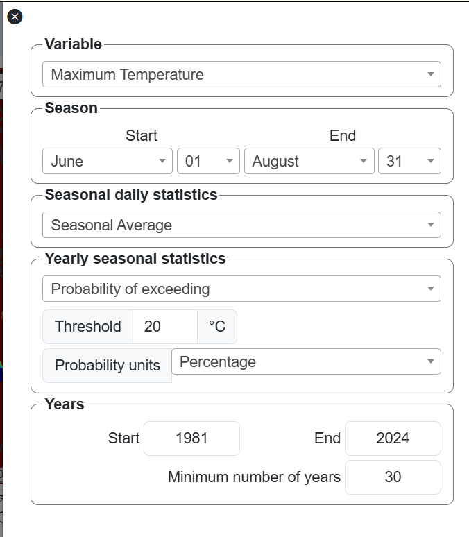
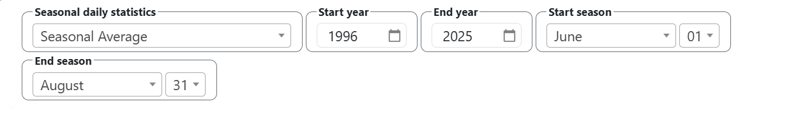
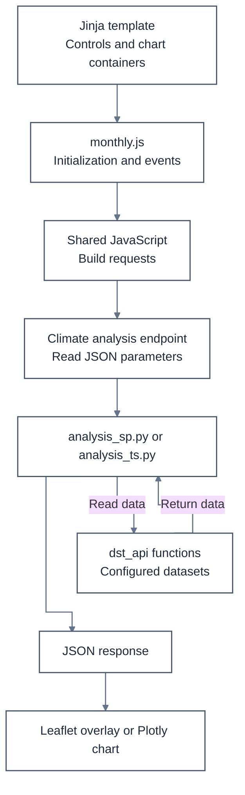

# 7. Module Content

[Chapter 6](6-module.md) established the initial page structure. This chapter explains how to develop the module content by connecting that structure to product controls, map calculations, chart previews, and expanded charts.

The development process follows three connected parts:

1. HTML templates define the interface and its controls.
2. JavaScript initializes those controls, sends requests, and displays results.
3. Python functions read datasets, perform calculations, and prepare the responses.

These parts work together. The templates create the elements that JavaScript reads and updates, while Python prepares the data required to display the maps and charts.

This chapter uses examples from monthly Climate analysis and DRM temperature analysis. Both follow the same overall development process, but they use different controls, settings, scripts, and calculation parameters.

| Example | Temporal resolution | Chart previews | Main purpose in this chapter |
|---|---|---|---|
| Monthly Climate analysis | monthly | Raw data, climatology, and anomalies | Explain the connections between templates, JavaScript, endpoints, and calculations |
| DRM temperature analysis | daily | Cumulative distribution function (CDF) and probability density function (PDF) | Explain product-specific controls and expanded charts |

Use the configuration, macros, and JavaScript functions associated with the product being developed.

In this chapter, a module refers to the product page being developed. The component is the application package containing its routes, templates, configuration, and scripts. For example, climate is the domain, analysis is the component, and monthly is the product page.

The code listings show the relevant parts of existing or illustrative implementations. Where an excerpt contains ellipses or comments indicating omitted content, retain the surrounding imports, initialization, validation, and processing required by the complete function.

## 7.1. HTML templates

The HTML templates establish the page structure and create the controls and containers used by the browser-side functions.

Jinja combines the shared layout, reusable macros, and page configuration when Flask renders the page. The resulting HTML provides the identifiers and classes that JavaScript uses to initialize the interface and display results.

### 7.1.1. Module HTML

As discussed previously, three macro namespaces are imported in *app/templates/layout.html*:

```html



```

Their responsibilities are:

| Namespace | Main responsibility |
|---|---|
| fmacros | Build shared page structures, including information cards, map controls, chart cards, and dialogs |
| fmacrosMap | Create product-specific map-control inputs |
| fmacrosExp | Create controls inside expanded-chart dialogs |

The initial template can now be extended by adding the appropriate control macros, chart dialogs, and JavaScript connections.

The following sections first explain the page blocks and macro calls, then show how configuration values and JavaScript are connected to the template.

#### 7.1.1.1. Extend the shared layout and define page blocks

The module template extends the shared layout:

    app/templates/layout.html

Each HTML template generally begins with:

```html



{{ metInfo.pageTitle }}



{{ super() }}

```

The extends statement connects the product page to the shared layout.

The title block defines the browser page title. The value of metInfo.pageTitle comes from the institutional configuration.

The head block allows page-specific additions. Calling *super()* preserves the scripts, styles, and other header content supplied by the shared layout.

The main page content is defined inside:

```html

    ...

```

Page-specific JavaScript is loaded through:

```html

    ...

```

These blocks organize the interface structure and its browser-side behavior within the shared page layout.

The following DRM analysis example illustrates the content structure used by a component page. It places the information panel on the left, the map on the right, and two chart previews below the map:

```html

<!--  -->
<div class="container-fluid" id="container-page">
    <div class="row">
        <div class="col-sm-4">
            {{ fmacros.create_card_information(pageText.description, pageText.instruction) }}
        </div>

        <div class="col-sm-8">
            <div class="row">
                <div class="col-sm-12 col-map-container">
                    <div id="div-map-container" class="div-map-container">
                        
                            {{ fmacrosMap.create_map_control_drm_analysis_temperature("daily", pageText) }}
                        
                    </div>
                </div>
            </div>

            <div class="row justify-content-center">
                <div class="col-sm-6">
                    {{ fmacros.create_card_charts("div-chart-cdf", pageText) }}

                    
                        {{ fmacrosExp.create_expand_charts_drmExt_cdf("daily", pageText, "temperature") }}
                    
                </div>

                <div class="col-sm-6">
                    {{ fmacros.create_card_charts("div-chart-pdf", pageText) }}

                    
                        {{ fmacrosExp.create_expand_charts_drmExt_pdf("daily", pageText, "temperature") }}
                    
                </div>
            </div>
        </div>
    </div>

    {{ fmacros.create_modal_matplotlib(pageText) }}
</div>

```

This example brings together the main interface elements introduced in [Chapter 6](6-module.md#622-create-the-html-placeholder). The following section explains how the macro calls create those elements and how their arguments connect them to the selected product.

#### 7.1.1.2. Call macros from the module template

A macro creates reusable HTML. Some macros directly produce a component, while others provide a wrapper containing additional content.

The calling syntax depends on the role of the macro:

| Syntax | Purpose | When to use |
|---|---|---|
| {{ namespace.macro(arguments) }} | Output the HTML returned by a macro | Render cards or specialized controls |
|  ...  | Pass nested content to a macro through caller() | Render wrappers containing other components |
|  | Import a macro library under an alias | Make its macros available in the template |
|  | Render a shared template fragment | Reuse template content with the available context |

A wrapper macro used with a call block invokes caller() inside its definition to place the nested content.

The examples pass values such as pageText explicitly to the macros. This makes the required configuration available to the macro through its arguments.

For example, the monthly Climate analysis page creates its map-control area with:

```html
<div id="div-map-container" class="div-map-container">
    
        {{ fmacrosMap.create_map_control_inputs("monthly", pageText) }}
    
</div>
```

The outer macro, *create_map_control()*, creates the shared toolbar and control panels.

The inner macro, *create_map_control_inputs()*, creates the inputs used by Climate analysis.

These macros are defined in the shared template files under:

    app/templates/

The *create_map_control_inputs()* macro accepts the following arguments:

| Argument | Meaning |
|---|---|
| "monthly" | Identify the temporal resolution and the prefix used in generated HTML identifiers |
| pageText | Provide the assembled labels, options, defaults, and other page settings |

For example, the macro generates a variable selector with an identifier based on tempRes:

```html
<select
    id="{{ tempRes }}-map-variable"
    class="form-select form-select2-nosearch"
>
    
        <option value="{{ key }}">{{ value }}</option>
    
</select>
```

With tempRes set to "monthly", the identifier becomes:

    monthly-map-variable

The **tempRes** argument identifies the temporal resolution, such as daily, dekadal, monthly, or seasonal. Use a value supported by the selected macro, its JavaScript functions, and the available datasets.

JavaScript later reads this exact identifier. The prefix must therefore remain consistent between the template and the functions that read the control values.

The HTML div elements and Bootstrap column classes determine the arrangement of the information panel, map, and charts.

The *create_card_information()* macro places the description and instructions in the information column.

Each chart card is paired with an *expanded-chart* dialog. Both receive the same chart identifier so that their buttons, dialog containers, and JavaScript connections remain consistent.

The earlier DRM example uses a different product-specific map-control macro:

    app/templates/control-map-macros.html

Its definition follows this structure:

```html

<div class="container">
    {# Product-specific control inputs are defined here. #}
</div>

```

This outline shows how the macro is declared. [Section 7.1.2.1](#7121-map-container-and-map-control-macros) develops the example further by adding control fields.

The expanded-chart macros are maintained separately in:

    app/templates/control-expand-macros.html

Map controls and expanded-chart controls can offer related options, but their contents depend on their respective roles in the product.

Use the shared template structure for both types of controls to keep their basic behavior consistent across components. Product-specific fields can then be added within the corresponding macro.

#### 7.1.1.3. Pass configuration and load page JavaScript

Flask assembles the template context before rendering the page.

As described in the [architecture chapter](5-maproom-structure.md#514-configuration-hierarchy), *load_maproom_page_text()* combines shared settings with the selected product's YAML configuration. The assembled values are passed to the template as pageText.

The template uses these values to create labels, selection options, and other interface content. Selected configuration values must also be made available to JavaScript so that browser-side functions can initialize the controls and construct requests.

The component's *block-js.html* exposes selected context values to JavaScript:

    app/climate/analysis/templates/block-js.html

For Climate analysis, these include:

| JavaScript variable | Template value | Purpose |
|---|---|---|
| DATA_USERS | dataUser | Current user information |
| MTO_INIT | metInfo | Institutional and initial map settings |
| LANG_USER | langUser | Language and locale settings |
| DATA_INFO | dataInfo | Dataset coverage and resolution information |
| JS_TEXT | pageText.js_text | Shared JavaScript interface messages |
| LAYERS | pageText.layers | Geographic and map-layer settings |
| BASE_PERIOD | pageText.base_period | Default reference-period settings |
| SEASON_DEF | pageText.default_season | Default season settings |
| URL_ARGS | urlArgs | Current domain, component, and page identifiers |

The monthly template adds its own dataset and threshold settings, then loads its JavaScript:

```html

    

    <script>
        var DATA_SET = JSON.parse('{{ pageText.dataset | tojson }}');
        const THRESHOLD_DEF = JSON.parse('{{ pageText.opt_threshold | tojson }}');
    </script>

    <script
        type="text/javascript"
        src="{{ url_for('climate_analysis.static', filename='js/monthly.js') }}">
    </script>

```

The tojson filter serializes the configuration values for JavaScript. These examples retain the existing convention of passing the serialized value through *JSON.parse()*.

*DATA_SET* identifies the selected dataset and variables. *THRESHOLD_DEF* provides the default threshold values and units used by the controls.

These values are defined in the active page configuration:

    app/climate/analysis/yaml/monthly.yaml

For example:

```yaml
dataset:
    use: ALL
    variables:
        rainfall: [precip]
        max_temperature: [tmax]
        min_temperature: [tmin]

opt_threshold:
    value:
        rainfall: 100
        max_temperature: 30
        min_temperature: 10
    unit:
        rainfall: mm
        max_temperature: °C
        min_temperature: °C
```

These are configuration excerpts. Retain the other labels and options required by the complete monthly template.

The macros use the assembled configuration to create the selection options and labels. JavaScript initialization functions then apply the required defaults and populate controls that are created without options, such as some date selectors.

**Existing DRM JavaScript example**

The DRM temperature product exposes additional parameter settings:

```html

    

    <script>
        const PARAMS_LIST = JSON.parse('{{ pageText.parameters | tojson }}');

        // PARAMS_LIST.tmin = PARAMS_LIST.temperature;
        // PARAMS_LIST.tmax = PARAMS_LIST.temperature;

        const PARAMS_ORDER = JSON.parse('{{ pageText.parameters_order | tojson }}');

        // const PARAMS_DEF = JSON.parse('{{ pageText.definition | tojson }}');

        const PROBA_PLOT = JSON.parse('{{ pageText.opt_js_data | tojson }}');
    </script>

    <script
        type="text/javascript"
        src="{{ url_for('drm_analysis.static', filename='js/ext_temperature.js') }}">
    </script>

```

This block belongs to the DRM product. Its active declarations require *parameters*, *parameters_order*, and *opt_js_data* in the assembled page configuration.

The commented assignments retain examples of additional parameter handling.

Use the JavaScript block associated with the selected product. The monthly Climate analysis and DRM temperature examples use different settings and scripts.

When writing a new script block, a value serialized with tojson can also be assigned directly:

```html
<script>
    var DATA_SET = {{ pageText.dataset | tojson }};
    const THRESHOLD_DEF = {{ pageText.opt_threshold | tojson }};
</script>
```

This form avoids an additional JavaScript string layer and parsing step. It provides the same configuration objects to the page functions.

Page rendering and calculation requests are separate stages. Flask first renders the HTML and configuration values. After the page reaches the browser, JavaScript initializes the controls and sends requests for map or chart data. The returned results update the existing interface.

With the configuration available, the next step is to examine the macros that create the map controls, preview cards, and expanded-chart dialogs.

### 7.1.2. Map and chart macros

The shared macros create the interface structures. Their behavior is completed by the [JavaScript](#72-static-javascript) and [Python](#73-python-scripts) connections described later in this chapter.

[Section 7.1.1](#711-module-html) explained how the module template calls these macros. This section describes the structures they create and the identifiers that connect them to JavaScript.

The principal shared macros are:

| Macro and example arguments | Purpose | When and how to use |
|---|---|---|
| fmacros.create_card_information(pageText.description, pageText.instruction) | Create Description and Instructions tabs | Render in the information column |
| fmacros.create_map_control(pageText, urlArgs) | Create the map toolbar and offcanvas panels | Use a call block containing a fmacrosMap macro |
| fmacros.create_card_charts("div-chart-raw", pageText) | Create a chart preview container and buttons | Render once for each preview chart |
| fmacros.create_modal_expand_charts("div-chart-raw", pageText) | Create the expanded-chart dialog and toolbar | Use a call block containing a fmacrosExp macro |
| fmacros.toolbar_modal_expand_charts("div-chart-raw", pageText) | Create range-selection and chart-action buttons | Already included by create_modal_expand_charts() |
| fmacros.create_modal_matplotlib(pageText) | Create the Matplotlib map dialog container | Include once when supporting that map action |
| fmacros.create_settings_dialog("custom-settings", pageText, "Settings") | Create a settings panel | Use a call block containing the settings fields |
| fmacros.baseline_period_dialog("monthly-chart-anom-bp", pageText) | Create reference-period fields | Reuse for start year, end year, and minimum-year settings |
| fmacros.tmp_placeholder_image(urlArgs) | Display navigation details and a default image | Use for temporary or unfinished pages |

#### 7.1.2.1. Map container and map-control macros

The map container provides the HTML element in which Leaflet creates the map:

```html
<div id="div-map-container" class="div-map-container"></div>
```

The map-control wrapper is defined in:

    app/templates/macros.html

Product-specific map inputs are defined in:

    app/templates/control-map-macros.html

For monthly Climate analysis, *create_map_control_inputs()* creates controls for the variable, display type, date, climatology function, anomaly type, and reference period.

Relevant generated identifiers include:

| HTML identifier | Used for |
|---|---|
| monthly-map-variable | Selected climate variable |
| monthly-map-type | Climatology, anomaly, or raw-data display |
| monthly-map-date-calendar | Selected date or climatological month |
| monthly-map-climato-func | Selected climatology calculation |
| monthly-map-anomaly-type | Selected anomaly calculation |
| monthly-base-period-start | Reference-period start year |
| monthly-base-period-end | Reference-period end year |
| monthly-base-period-min | Minimum number of years |

These identifiers connect the template to the shared JavaScript. A function that reads monthly-map-variable, for example, depends on the template creating an element with that exact identifier.

Available map-control macros include:

- fmacrosMap.create_map_control_inputs()
- fmacrosMap.create_map_control_daily()
- fmacrosMap.create_map_control_telecon_sp()
- fmacrosMap.create_map_control_rainy_season()
- fmacrosMap.create_map_control_decision_support()
- fmacrosMap.create_map_control_crop_suitability()
- fmacrosMap.create_map_control_monitoring()
- fmacrosMap.create_map_control_drm_analysis_temperature()
- fmacrosMap.create_map_control_drm_analysis_rainfall()
- fmacrosMap.create_map_control_drm_analysis_spi()
- fmacrosMap.create_map_control_spi_proj()
- fmacrosMap.create_map_control_model_proj()
- fmacrosMap.create_map_control_seasonal_proj()
- fmacrosMap.create_map_control_health_wasp()
- fmacrosMap.create_map_control_health_cmst()
- fmacrosMap.create_map_control_seasfcst()
- fmacrosMap.create_map_control_tendaysfcst()

The list identifies available macro names. Pass the arguments required by the selected macro's definition.

Developers can add another macro when an existing control structure does not cover the required product behavior.

Returning to the DRM temperature example, its map-control macro is defined in:

    app/templates/control-map-macros.html

The following excerpt develops the declaration introduced in [section 7.1.1.2](#7112-call-macros-from-the-module-template) by adding variable, season, and statistical-parameter fields:

```html

<div class="container">
    

    <fieldset class="border border-secondary rounded-3">
        <legend class="legend-label">{{ pageText.variables.label }}</legend>

        <select id="{{ tempRes }}-map-variable" class="form-select form-select2-nosearch">
            
                <option value="{{ key }}">{{ value }}</option>
            
        </select>
    </fieldset>

    <fieldset class="border border-secondary rounded-3">
        <legend class="legend-label">{{ pageText.opt_season_map.label_season }}</legend>

        <div class="container-fluid px-0">
            <div class="row gx-1">
                <div class="col-md-6 text-center">
                    {{ pageText.opt_season_map.start_date }}
                </div>

                <div class="col-md-6 text-center">
                    {{ pageText.opt_season_map.end_date }}
                </div>
            </div>

            {# Add more div elements here as needed. #}
        </div>
    </fieldset>

    {# Add more fieldset elements here as needed. #}

    <fieldset class="border border-secondary rounded-3">
        <legend class="legend-label">{{ pageText.label_statistics.params }}</legend>

        <select id="{{ tempRes }}-map-parameters" class="form-select form-select2-nosearch">
            
                <option value="{{ key }}">{{ value.select }}</option>
            
        </select>
    </fieldset>
</div>

```

The following image shows an example of the rendered map controls:

 

The excerpt illustrates part of the control structure. The complete panel shown in the image also contains season-date inputs, yearly seasonal statistics, threshold settings, probability units, and year-selection controls.

The complete template must create the elements read by its JavaScript functions. In the DRM temperature example, these include the date controls and elements whose identifiers end in *-map-def-number*, *-map-climato-probaTh*, and *-map-climato-parUnit*.

Setting *tstepID* defines an identifier prefix; it does not create the date inputs.

The values shown in the screenshot illustrate one selection. The product configuration and initialization functions determine the available options and initial values.

The corresponding expanded-chart control macros are defined in:

    app/templates/control-expand-macros.html

Both types of macros use configuration values assembled from YAML files and passed through pageText. These values provide labels, selection options, and defaults for the map and expanded-chart controls.

The templates create the control structure, while the associated JavaScript functions populate additional fields and manage changes in the selected values.

#### 7.1.2.2. Chart preview cards and expansion buttons

In the page's HTML template, the *create_card_charts()* macro creates the chart preview area and its toolbar buttons.

For example:

```html
{{ fmacros.create_card_charts("div-chart-raw", pageText) }}
```

This generates identifiers derived from the supplied chart ID:

| Element | Generated identifier |
|---|---|
| Preview chart | div-chart-raw |
| Expansion button | btn-div-chart-raw |
| Information button | info-preview-div-chart-raw |

The macro creates the containers and buttons. JavaScript requests the data and draws the chart.

Each chart must have its own identifier. The monthly Climate analysis page uses:

    div-chart-raw
    div-chart-clim
    div-chart-anom

These identifiers are reused when connecting the preview buttons to their expanded-chart dialogs and when selecting the containers in which Plotly draws the results.

The preview card therefore provides the visible chart area and the entry point to the corresponding expanded chart.

#### 7.1.2.3. Expanded-chart modal and control macros

The expanded-chart wrapper is defined in *macros.html*. Its product-specific controls are defined in *control-expand-macros.html*.

For example, the monthly raw-data chart uses:

```html

    {{ fmacrosExp.create_expand_charts_raw("monthly", pageText, urlArgs) }}

```

The outer macro creates the dialog and toolbar. The nested macro creates the controls used to select the variable, dates, and time-series display.

The monthly page uses:

| Chart | Control macro |
|---|---|
| Raw data | create_expand_charts_raw() |
| Climatology | create_expand_charts_clim() |
| Anomalies | create_expand_charts_anom() |

The climatology and anomaly macros receive fmacros because they reuse shared reference-period dialogs.

For the raw-data example, the wrapper creates:

    modal-expand-div-chart-raw
    modal-chart-div-chart-raw

JavaScript subsequently creates the Plotly drawing container inside that dialog.

The same general structure applies to product-specific expanded charts. The following simplified DRM example shows a statistical-parameter selector and season-end controls.

In this illustrative declaration, product represents the third argument passed as "temperature" in the earlier module-template example. The displayed fields use tempRes and pageText; additional product-specific handling belongs in the complete macro.

```html

<div class="container d-flex flex-wrap justify-content-start w-100" id="{{ tempRes }}-drmExt-pdf-control">
    <fieldset class="border border-secondary rounded-3 py-1">
        <legend class="legend-label">{{ pageText.label_statistics.params }}</legend>
        <!--  -->

        <select id="{{ tempRes }}-pdf-parameters" class="form-select {{ tempRes }}-pdf-select2" style="width: 300px;">
            
                <option value="{{ key }}">{{ value.select }}</option>
            
        </select>
    </fieldset>

    {# Add more div or fieldset elements here as needed. #}

    <fieldset class="border border-secondary rounded-3 py-1">
        <legend class="legend-label">{{ pageText.opt_season.label_season.end }}</legend>
        <!--  -->

        <div class="row w-auto">
            <div class="col-auto me-0 pe-0">
                <select id="{{ tempRes }}-pdf-end-mon" class="form-select {{ tempRes }}-pdf-select2" style="width: 150px;"></select>
            </div>

            <div class="col-auto ms-0 ps-1">
                <select id="{{ tempRes }}-pdf-end-day" class="form-select {{ tempRes }}-pdf-select2"></select>
            </div>
        </div>
    </fieldset>
    <!--  -->
</div>

```

The following image shows an example of the expanded-chart controls:

 

The excerpt is simplified. The screenshot also includes seasonal statistics, start and end years, and season-start controls. Retain the complete set of fields required by the product's JavaScript functions.

Each expanded chart can have its own control macro. Related charts can share a common structure while providing different options or calculations.

Next, connect the controls to JavaScript functions to populate date and variable inputs and manage conditional behavior, such as showing or hiding fields.

Many of these functions are already available in the Maproom. The module's page script, maintained in its *static/js/* directory, connects the page to shared functions under *app/static/js/*.

## 7.2. Static JavaScript

The templates provide the page elements, and JavaScript makes those elements respond to user actions.

The module's page script coordinates initialization and events. Shared scripts provide reusable functions for map controls, requests, geographic selection, chart previews, and expanded charts.

### 7.2.1. JavaScript for the module

Each page has its own JavaScript file. For example, the monthly Climate analysis page uses:

    app/climate/analysis/static/js/monthly.js

The page script connects the HTML structures to shared functions. Its main responsibilities are to initialize the page, register events, display the first map, and connect geographic selection to chart updates.

The shared layout makes the common JavaScript available before the product's page script uses it.

The following sections describe the main initialization and event-handling stages. The shared function definitions referenced by the page are explained in [section 7.2.2](#722-shared-javascript-used-by-the-module).

#### 7.2.1.1. Initialize the page, map, and controls

The existing script begins with:

```js
$(document).ready(function() {
    $('[data-bs-toggle="tooltip"]').tooltip();

    let map = createLeafletTileLayer(
        'div-map-container',
        MTO_INIT
    );

    setOffCanvasMapControl('monthly');

    // Remaining page initialization and event handlers follow here.
});

```

The code runs when the document is ready.

The *createLeafletTileLayer()* function receives:

| Argument | Purpose |
|---|---|
| 'div-map-container' | Identify the HTML map container |
| MTO_INIT | Supply the initial map position, zoom, and institutional settings |

It returns the Leaflet map used by later functions.

The *setOffCanvasMapControl('monthly')* function initializes the map inputs created by the monthly control macro.

This function is defined in the shared file:

    app/static/js/map-offcanvas-ctrl.js

[Section 7.2.2.4](#7224-map-offcanvas-ctrljs) explains its role in initializing and managing the map controls.

The script also initializes Select2 controls inside the expanded-chart dialogs:

```js
$('.monthly-raw-select2').select2({
    minimumResultsForSearch: -1,
    dropdownParent: $('#monthly-raw-control')
});

$('.monthly-clim-select2').select2({
    minimumResultsForSearch: -1,
    dropdownParent: $('#monthly-clim-control')
});

$('.monthly-anom-select2').select2({
    minimumResultsForSearch: -1,
    dropdownParent: $('#monthly-anom-control')
});
```

The selectors match classes generated by the expanded-chart macros.

The dropdownParent option places each dropdown within its corresponding control container, which is important for its display inside the dialog.

These excerpts belong inside the same document-ready callback as the map initialization.

At this stage, the map and control elements are available. The next step is to connect them to the functions that respond to user actions.

#### 7.2.1.2. Connect user events to shared functions

The page connects each preview expansion button to its corresponding dialog initializer:

```js
$('#btn-div-chart-raw').on('click', () => {
    setAnalysisExpandModalRaw('monthly', 'div-chart-raw');
});

$('#btn-div-chart-clim').on('click', () => {
    setAnalysisExpandModalClim('monthly', 'div-chart-clim');
});

$('#btn-div-chart-anom').on('click', () => {
    setAnalysisExpandModalAnom('monthly', 'div-chart-anom');
});

```

These button IDs are generated by *create_card_charts()*.

The shared functions open the appropriate dialog, initialize its controls, and connect it to chart requests.

The arguments identify:

- The temporal resolution, such as 'monthly'.
- The chart card and associated dialog, such as 'div-chart-raw'.

The page also connects the Matplotlib map button:

```js
$('#map-control-matplotlib').on('click', () => {
    showModalDialog('modal-map-matplotlib');
});
```

This opens the dialog created by *create_modal_matplotlib()*.

Map updates are connected to the data-selection panel and redraw button:

```js
const map_options = {};

$('#map-control-offcanvas-dataselect').on(
    'hidden.bs.offcanvas',
    () => {
        displayClimateAnalysisMap('monthly', map_options, map);
    }
);

$('#map-control-redraw').on('click', () => {
    displayClimateAnalysisMap('monthly', map_options, map);
});
```

Closing the data-selection panel requests a map using the current control values.

The redraw button requests the map explicitly.

Keep *map_options* and *map* in the same document-ready scope as these handlers.

Registering a handler defines what happens when an event occurs. The initial map request must also be called explicitly, as described in the [following section](#7213-trigger-map-and-chart-updates).

#### 7.2.1.3. Trigger map and chart updates

The map controls must be initialized before their values are used in a request.

The shared *app/static/js/map-offcanvas-ctrl.js* file manages the controls and their dependent fields. The following DRM temperature example illustrates how the selected statistical parameter affects the visible fields and default values:

```js
function setOffCanvasMapControlsDrmExtTemp(tempRes) {
    setAnalysisDateCalendarMonDay(tempRes, 'map-date');

    $(`#${tempRes}-map-parameters`)
        .off('change.drmExtTempParameters')
        .on('change.drmExtTempParameters', function() {
            const this_val = $(this).val();

            if (this_val === 'seasAvg') {
                // $(`#${tempRes}-map-def-number`).hide();
                setVisibility([], [`${tempRes}-map-def-number`]);
            } else {
                // $(`#${tempRes}-map-def-number`).show();
                setVisibility([`${tempRes}-map-def-number`], []);
            }

            $(`#${tempRes}-map-climato-probaTh`).val(PARAMS_LIST[this_val].value);
            $(`#${tempRes}-map-climato-parUnit`).text(PARAMS_LIST[this_val].unit);
        });

    $(`#${tempRes}-map-parameters`).trigger('change');

    // Add further control initialization here as needed.
}
```

The *setOffCanvasMapControlsDrmExtTemp()* function initializes the date controls and updates fields for the selected DRM temperature parameter.

In this excerpt, changing the parameter determines whether the additional definition field is visible. It also updates the parameter's default value and unit from *PARAMS_LIST*.

The final *trigger('change')* applies this behavior to the current selection during initialization.

Use *setVisibility()* or jQuery's *.hide()* and *.show()* methods to display or hide fields according to the selected parameter. The commented lines retain examples of the direct jQuery approach.

Although this shared function is shown here to explain the initialization sequence, it is maintained in the shared control script. [Section 7.2.2.4](#7224-map-offcanvas-ctrljs) returns to that file using the monthly Climate analysis initializer.

After initializing the controls, display the DRM analysis map using the current selections:

```js
displayDrmAnalysisMap('daily', map_options, map);
```

The arguments are:

| Argument | Purpose |
|---|---|
| 'daily' | Select the daily control and request conventions |
| map_options | Supply map-overlay display options |
| map | Identify the Leaflet map to update |

For monthly Climate analysis, the corresponding initial request is:

```js
displayClimateAnalysisMap('monthly', map_options, map);
```

Place the initial request inside the existing document-ready callback, after creating the map, initializing the controls, and declaring map_options.

Use the display function associated with the selected product.

For monthly Climate analysis, date navigation updates or validates the selected date before redrawing the map:

```js
$('#input-time-navigation').on('blur', async () => {
    const ret = await setMapDatesNavInput('monthly');

    if (ret) {
        displayClimateAnalysisMap('monthly', map_options, map);
    }
});

$('#prev-time-navigation').on('click', async () => {
    const ret = await setMapDatesNavPrev('monthly');

    if (ret) {
        displayClimateAnalysisMap('monthly', map_options, map);
    }
});

$('#next-time-navigation').on('click', async () => {
    const ret = await setMapDatesNavNext('monthly');

    if (ret) {
        displayClimateAnalysisMap('monthly', map_options, map);
    }
});
```

When a product does not require time navigation, hide the time-navigation controls on the Leaflet map with:

```js
// Hide map time navigation.
$('#div-map-time-navigation').removeClass('d-flex').addClass('d-none');
```

Chart previews are connected to point or polygon selection:

```js
mapClickLayersSpatialAverage(preview_analysis_display_charts, 'monthly', map);
```

The first argument is a callback function. The geographic-selection helpers call it after the selected location or polygon is available.

The existing script also reconnects geographic-selection behavior when the displayed country or region changes:

```js
$('#select-country-region').on('change', () => {
    mapClickLayersSpatialAverage(preview_analysis_display_charts, 'monthly', map);
});

$('#select-region-name').on('change', () => {
    mapClickLayersSpatialAverage(preview_analysis_display_charts, 'monthly', map);
});
```

The callback updates the three monthly chart previews:

```js
function preview_analysis_display_charts(tempRes) {
    preview_analysis_charts_rawdata(tempRes, 'div-chart-raw');
    preview_analysis_charts_climato(tempRes, 'div-chart-clim');
    preview_analysis_charts_anomaly(tempRes, 'div-chart-anom');
}
```

The map and chart paths therefore have different triggers:

- The initial page load requests the map.
- Map settings and date navigation request further maps.
- Geographic selection provides the location needed for chart requests.

The initialization process can be followed in this order:

1. Make the shared scripts and page configuration available.
2. Wait until the page elements are ready.
3. Create the Leaflet map.
4. Initialize the map and chart controls.
5. Register the page's event handlers.
6. Request the initial map.
7. Connect geographic selection to chart-preview updates.

The page script coordinates these actions. The [following sections](#722-shared-javascript-used-by-the-module) explain the shared functions that build the requests and display the returned results.

### 7.2.2. Shared JavaScript used by the module

The page reuses functions maintained under:

    app/static/js/

These shared files connect the product's controls to its endpoints and rendering functions.

The page script determines when a function is called. The shared functions read the required settings, prepare requests, manage responses, and update the relevant map or chart containers.

#### 7.2.2.1. leaflet-map-settings.js

The following shared file reads the map-control values and prepares the climate-map request:

    app/static/js/leaflet-map-settings.js

The main functions for the monthly Climate analysis example are:

| Function | Responsibility |
|---|---|
| *queryParamsClimateAnalysisMap()* | Read controls and construct the request parameters |
| *displayClimateAnalysisMap()* | Resolve the endpoint and send the request |
| *updateAnalysisMapDate()* | Update the map's displayed date information |

The *queryParamsClimateAnalysisMap('monthly')* function reads values such as:

| Request value | Source |
|---|---|
| temporalRes | Function argument |
| dataset | DATA_SET.use |
| variable | monthly-map-variable |
| mapType | monthly-map-type |
| Date or climDate | Selected date or climatological month |
| climFunction | Selected climatology function |
| anomaly | Selected anomaly type |
| startYear, endYear, minYear | Reference-period controls |
| colorbar | Shared color-control settings |

The required fields depend on the selected map type.

For example, a monthly climatology uses a climatological month, while raw-data and anomaly maps use a selected date.

The request is sent through:

```js
function displayClimateAnalysisMap(time_res, options, map) {
    const query = queryParamsClimateAnalysisMap(time_res);

    if (!query) {
        return false;
    }

    const endpoint = createEndpoint(
        'climate_analysis',
        'climate_analysis_map'
    );

    const request = ajaxLeafletMap(
        endpoint,
        query,
        displayRasterImage,
        options,
        map
    );

    updateAnalysisMapDate(time_res, query, map);

    return request;
}
```

The *createEndpoint()* function resolves the Flask endpoint name through the URL helper exposed by JSGlue.

The *ajaxLeafletMap()* function sends the JSON parameters and checks the returned status.

For a successful response, it passes the returned payload to *displayRasterImage()*.

The following excerpt shows how *queryParamsClimateAnalysisMap()* begins assembling the request parameters:

```js
function queryParamsClimateAnalysisMap(time_res) {
    let query = new Object();

    query.temporalRes = time_res;
    query.dataset = DATA_SET.use;
    query.variable = $(`#${time_res}-map-variable`).val();
    query.mapType = $(`#${time_res}-map-type`).val();

    const tstep_id = `${time_res}-map-date`;
    const bp_id = `${time_res}-base-period`;

    ...

    // Read and validate the remaining required request parameters here.

    query.colorbar = colorbar;

    return query;
}
```

The ellipsis represents the omitted logic for reading and validating the remaining fields. The complete function must also prepare the colorbar value before assigning it to the query.

Together, the query builder and request function connect the selected map controls to the Python endpoint.

The *displayRasterImage()* callback then displays the image overlay, legend, and related map information.

#### 7.2.2.2. plotly-preview.js

This file prepares requests and renders the small chart previews.

Each chart follows three steps:

1. Build the request parameters.
2. Request the data.
3. Format the response for Plotly.

The preview-update callback must correspond to the chart containers created by the template.

The following listing repeats the callback introduced in [section 7.2.1.3](#7213-trigger-map-and-chart-updates). There, it connects geographic selection to chart updates. Here, it shows how one callback starts the requests for the three monthly Climate analysis previews.

Both listings refer to the same function definition:

```js
function preview_analysis_display_charts(tempRes) {
    preview_analysis_charts_rawdata(tempRes, 'div-chart-raw');
    preview_analysis_charts_climato(tempRes, 'div-chart-clim');
    preview_analysis_charts_anomaly(tempRes, 'div-chart-anom');
}
```

The chart identifiers must match those used in the HTML template and the page's JavaScript connections.

Each preview follows the same general request process as the map: prepare the parameters, request the data, and display the response.

For a raw-data preview, the functions are:

```js
preview_analysis_query_rawdata()
preview_analysis_charts_rawdata()
preview_analysis_display_rawdata()
```

The query builder combines the geographic selection with the dataset, variable, temporal resolution, and preview period.

The request function is:

```js
function preview_analysis_charts_rawdata(tempRes, contID) {
    const query = preview_analysis_query_rawdata(tempRes);

    if (!query) {
        return false;
    }

    if (checkQueryPointOutside(query, tempRes)) {
        flashMessage(JS_TEXT.point_outside, 'error');
        return false;
    }

    ajaxDisplayChart(
        '/climate_analysis_rawdata',
        query,
        preview_analysis_display_rawdata,
        contID
    );
}
```

Its arguments identify the temporal resolution and the preview container.

The function first checks that a query is available. It then checks whether the selected point is outside the supported area before sending the request.

The *ajaxDisplayChart()* helper sends the request, checks the returned status, and passes json.data to the display callback.

The *preview_analysis_display_rawdata()* function constructs the Plotly traces and layout. In the existing implementation, rainfall uses a bar preview, while other supported variables use a line-based preview.

The monthly previews follow the same pattern:

| Preview | Endpoint | Display function |
|---|---|---|
| Raw data | /climate_analysis_rawdata | *preview_analysis_display_rawdata()* |
| Climatology | /climate_analysis_climato | *preview_analysis_display_climato()* |
| Anomalies | /climate_analysis_anomaly | *preview_analysis_display_anomaly()* |

The geographic parameters come from *queryParamsSpatialAverage()* in *leaflet-map.js*.

For a grid point, that helper supplies the selected coordinates. For a polygon, it supplies the configured boundary information and polygon identifier.

The display callback receives the data payload after the shared request helper has handled the outer response status.

This allows the display function to focus on preparing the Plotly chart from the successful calculation result.

#### 7.2.2.3. plotly-expand.js

This file requests and formats the data displayed in expanded charts.

Expanded charts use controls inside their dialogs. Their queries can therefore differ from the preview queries, even when they call the same Python endpoint.

For example, the expanded raw-data query reads:

- The variable selected in the dialog.
- The selected start and end dates.
- The dataset and temporal resolution.
- The current geographic selection.

Its request function is:

```js
function expand_analysis_charts_rawdata(container_id, tempRes) {
    const query = expand_analysis_query_rawdata(tempRes);

    if (!query) {
        return false;
    }

    if (checkQueryPointOutside(query, tempRes)) {
        flashMessage(JS_TEXT.point_outside, 'error');
        return false;
    }

    ajaxDisplayChart(
        '/climate_analysis_rawdata',
        query,
        expand_analysis_display_rawdata,
        container_id,
        'ts_rawdata'
    );
}
```

The final argument, 'ts_rawdata', asks the shared helper to store the returned payload in the browser's local data store.

Some presentation changes can then redraw the chart from those stored values.

Changes that affect the requested calculation require a new request. Presentation changes supported by the existing chart settings can reuse the stored response data.

The main monthly expanded-chart functions are:

| Chart | Query function | Request function | Display function |
|---|---|---|---|
| Raw data | expand_analysis_query_rawdata() | expand_analysis_charts_rawdata() | expand_analysis_display_rawdata() |
| Climatology | expand_analysis_query_climato() | expand_analysis_charts_climato() | expand_analysis_display_climato() |
| Anomalies | expand_analysis_query_anomaly() | expand_analysis_charts_anomaly() | expand_analysis_display_anomaly() |

Dialog initialization is maintained in:

    app/static/js/expand-charts.js

For example, *setAnalysisExpandModalRaw()* opens the dialog, initializes its controls, and connects variable changes, replot actions, and downloads.

The expanded-chart process begins when the user clicks the preview's expansion button. The initializer prepares the dialog and connects its controls to the corresponding request functions.

The shared *expandModalCharts()* helper creates a drawing container inside the dialog. For div-chart-raw, that container is:

    container-chart-div-chart-raw

The display function then builds the Plotly traces, layout, and chart configuration in that container.

Additional presentation settings are maintained in:

    app/static/js/expand-charts-settings.js

The expanded-chart template, dialog initializer, request function, and display function must therefore use consistent control identifiers and response fields.

#### 7.2.2.4. map-offcanvas-ctrl.js

This file initializes the map-control inputs and manages their relationships.

[Section 7.2.1.3](#7213-trigger-map-and-chart-updates) illustrated product-specific behavior with the DRM temperature controls. This section returns to the monthly Climate analysis initializer.

For monthly Climate analysis, the main initializer is:

```js
setOffCanvasMapControl('monthly');
```

The function connects changes in the variable, map type, and climatology function to the appropriate updates.

The existing implementation includes:

```js
$(`#${tempRes}-map-variable`)
    .off(`change.${tempRes}Variable`)
    .on(`change.${tempRes}Variable`, function() {
        refreshSpatialAverage(tempRes, datasetFromVariable = false);
        setAnalysisThresholdDef(tempRes);
    });

$(`#${tempRes}-map-climato-func`)
    .off(`change.${tempRes}ClimatoFunc`)
    .on(`change.${tempRes}ClimatoFunc`, function() {
        setAnalysisClimatoFun(tempRes);
    });

$(`#${tempRes}-map-type`)
    .off(`change.${tempRes}MapType`)
    .on(`change.${tempRes}MapType`, function() {
        setAnalysisDateCalendarVisibility(tempRes, $(this).val());
        refreshSpatialAverage(tempRes, datasetFromVariable = false);
    });
```

These excerpts belong to *setOffCanvasMapControl()*.

The related functions include:

| Function | Responsibility |
|---|---|
| *setAnalysisThresholdDef()* | Set default threshold values and units for the selected variable |
| *setAnalysisClimatoFun()* | Show the controls required by the selected climatology function |
| *setAnalysisDateCalendarVisibility()* | Adapt date controls to the selected map type |
| *refreshSpatialAverage()* | Refresh geographic-selection settings for the current data choices |

For example, percentile calculations display a percentile input, while frequency calculations display an operator and threshold.

At the end of initialization, the function triggers the relevant change events so that dependent controls receive their initial values.

These functions manage the controls. The page-level handlers described in [section 7.2.1](#721-javascript-for-the-module) determine when the current settings are submitted for a map update.

Once JavaScript has assembled and sent the request, the component's Python endpoint receives the parameters and connects them to the required calculation.

## 7.3. Python scripts

Python provides the backend processing required by the maps and charts.

The component's routes receive the requests, its calculation functions prepare the results, and shared packages provide reusable dataset access, statistical methods, image generation, and caching.

### 7.3.1. Scripts related to the module

The Climate analysis component maintains its calculations under:

    app/climate/analysis/scripts/

The main files discussed here are:


    __init__.py
    icons.py
    analysis_sp.py
    analysis_ts.py

The component's *index.py* imports the relevant functions and exposes them through Flask endpoints.

Each component can define its own Python scripts for the backend processing it requires, including spatial calculations, time-series calculations, and other product-specific operations.

Many shared dataset operations and calculations are already available through the dst_api submodule. Import and reuse these functions where appropriate, and keep calculations specific to the product in the component's scripts/ directory.

For example, the Climate and Health component keeps its WASP calculation in its own scripts, while shared calculations such as SPI can be accessed through dst_api.

The following sections explain the package structure, icon generation, spatial calculations, and time-series calculations.

#### 7.3.1.1. Initialize the scripts package

The scripts directory uses an *__init__.py* file as part of the project's Python package organization:

    app/climate/analysis/scripts/__init__.py

It can remain empty when no package-level imports or initialization are required.

Functions can be imported directly from their modules. For example, the component's index.py can use:

```python
from .scripts.analysis_sp import climate_analysis_sp_data

from .scripts.analysis_ts import (
    climate_analysis_ts_rawdata,
    climate_analysis_ts_anomaly,
    climate_analysis_ts_climato,
)
```

These relative imports connect the route definitions to the calculation functions they use.

Other packages may use their *__init__.py* files to expose functions, as dst_api does. Follow the organization of the package being extended.

#### 7.3.1.2. Create an icon script

Product and component icons are maintained in:

    app/climate/analysis/scripts/icons.py

The existing module provides functions such as:

    icon_daily_analysis()
    icon_dekadal_analysis()
    icon_monthly_analysis()

For example, the monthly icon function uses a sample rainfall dataset:

```python
def icon_monthly_analysis():
    from app.scripts._cache import cache
    from app.dst_api.scripts import get_netcdf_data
    from app.dst_api.scripts import read_shapefiles
    from app.scripts.icons import create_icon_data

    cached_data = cache.get('icon_monthly_analysis')

    if cached_data is None:
        map_colors = COLORS_MAPROOM['precipitation_1']
        data = get_netcdf_data('ALL', 'dekadal', 'precip', '2010-08-3')
        shapefile = _get_layers_shapefiles()
        gdf = read_shapefiles(shapefile)

        if gdf['status'] == -1:
            print(gdf['message'])

        cached_data = create_icon_data(
            data,
            colors=map_colors['colors'],
            colors_ext=map_colors['ext'],
            gdf_boundaries=gdf['shp'],
        )

        cache.set('icon_monthly_analysis', cached_data)

    return cached_data
```

This excerpt uses *COLORS_MAPROOM* and *_get_layers_shapefiles()* from the existing module.

The function:

1. Checks whether the icon is already cached.
2. Reads a sample rainfall field.
3. Reads the configured boundary information.
4. Generates an encoded image.
5. Stores the result for reuse.

Although the function is named *icon_monthly_analysis()*, its existing sample is a dekadal rainfall field. The icon's name identifies its navigation role; the selected sample determines the data shown in the image.

The shown shapefile error branch prints a message and then continues. When adapting this excerpt into a complete implementation, ensure that unsuccessful boundary loading is handled before accessing gdf['shp'], using the error behavior expected by the icon loader.

Make the function available through:

    app/scripts/icons.py

Then reference its name through *icon_function* in the navigation YAML, as described in  [Chapter 6](6-module.md#6131-generate-an-icon-through-a-python-function).

The icon supports navigation to the product. The following sections describe the calculations used after the product page has loaded.

#### 7.3.1.3. Implement spatial calculations for maps

Spatial calculations are maintained in:

    app/climate/analysis/scripts/analysis_sp.py

The principal entry point is:

```python
climate_analysis_sp_data(params)
```

The map endpoint in *app/climate/analysis/index.py* calls it:

```python
@climate_analysis.route('/climate_analysis_map', methods=['POST'])
def climate_analysis_map():
    params = request.get_json()

    try:
        map_data = climate_analysis_sp_data(params)
        return json.dumps(map_data)
    except Exception as e:
        return json.dumps({
            'status': -1,
            'message': str(e),
        })
#
```

The route receives the JSON parameters constructed by JavaScript.

The parameter names must remain consistent between the JavaScript query builder and the Python calculation function. For example, the dataset, variable, selected date, map type, and color settings must be provided in the structure expected by the calculation.

The calculation function first validates the selected colors and retrieves the requested data:

```python
check = check_invalid_colors(params['colorbar'])

if check['status'] == -1:
    return check

data = get_climate_analysis_sp_data(params)

if data['status'] == -1:
    return data
```

The *get_climate_analysis_sp_data()* function selects the appropriate dataset operation.

For the monthly, non-daily analysis path:

| Selected map type | Main dataset function |
|---|---|
| climatology | download_climdata() |
| rawdata | download_rawdata() |
| anomaly | download_analysis() |

Helper functions such as *_create_params_sp_clim()*, *_create_params_sp_raw()*, and *_create_params_sp_anom()* add the parameters required by the corresponding operation.

The returned spatial data is parsed through *parse_json_spatial_data()*.

The calculation then creates the colored map image. For a preset color scale, the existing function uses:

```python
map_png = create_imagePng(
    data,
    breaks=params['colorbar']['break_cbar'],
    color_name=params['colorbar']['color_cbar'],
    colors_ext=params['colorbar']['color_ext'],
)
```

For custom colors, it passes the configured color list through the colors argument instead.

The function adds the date and legend title, then returns:

```python
map_png['date'] = data['date']
map_png['ckeys']['title'] = f"{data['longname']} ({data['units']})"

return {
    'status': 0,
    'data': map_png,
}
```

The successful response provides:

- An encoded PNG overlay.
- Its geographic bounds.
- Color-scale and legend information.
- Date information.

The examples use an outer response structure containing status and either a successful data payload or an error message.

The shared JavaScript request helper checks this outer structure before passing the successful payload to the display function.

For a map response, the helper passes the payload to *displayRasterImage()*, which updates Leaflet.

The spatial calculation therefore prepares both the climate result and the information required to display it correctly. Keeping the image, bounds, legend, and date together allows the browser to update the map consistently.

#### 7.3.1.4. Implement time-series calculations for charts

Time-series calculations are maintained in:

    app/climate/analysis/scripts/analysis_ts.py

The monthly page uses:

| Function | Purpose |
|---|---|
| *climate_analysis_ts_rawdata()* | Prepare the selected historical time series |
| *climate_analysis_ts_climato()* | Prepare climatological values and supporting statistics |
| *climate_analysis_ts_anomaly()* | Prepare the selected anomaly series |

The raw-data endpoint illustrates the connection:

```python
@climate_analysis.route('/climate_analysis_rawdata', methods=['POST'])
def climate_analysis_rawdata():
    params = request.get_json()

    try:
        return cache_data_functions(
            climate_analysis_ts_rawdata,
            hash_params_ts_data,
            params,
        )
    except Exception as e:
        return json.dumps({
            'status': -1,
            'message': str(e),
        })
```

The cache helper calls *climate_analysis_ts_rawdata()* when a matching result is unavailable.

The *hash_params_ts_data()* function is defined in:

    app/scripts/_cache.py

[Section 7.3.2.2](#7322-shared-caching) explains the shared caching process.

The *climate_analysis_ts_rawdata()* function begins by retrieving the time series:

```python
raw_ts = _download_ts_rawdata(params)

if raw_ts['status'] == -1:
    return raw_ts

time = raw_ts['data']['time']
values = raw_ts['data']['values']
info = raw_ts['data']['info']
```

The *_download_ts_rawdata()* function prepares the extraction parameters, calls the appropriate dataset function, formats the dates, and handles the source missing-value identifier.

For the monthly path, it calls *download_rawdata()*.

The calculation prepares axis information and converts missing numeric values to None for the response:

```python
vmin = np.nanmin(values)
vmax = np.nanmax(values)

if params['variable'] == 'precip':
    vmin = 0

breaks = pretty(vmin, vmax, 14).tolist()

ylim = [breaks[0], breaks[-1]]
ex = (ylim[1] - ylim[0]) * 0.01
ylim[1] = ylim[1] + ex

values = np.where(np.isnan(values), None, values)

data = {
    'time': time,
    'values': values.tolist(),
    'info': info,
    'yrange': ylim,
    'yticks': breaks,
}

return {
    'status': 0,
    'data': data,
}
```

This excerpt shows the successful-data branch. The complete existing function also handles the case where all values are missing and returns an explanatory error.

The response fields are used by the JavaScript display functions:

| Field | Purpose |
|---|---|
| time | Dates used on the horizontal axis |
| values | Values to plot |
| info | Geographic, variable, unit, and temporal-resolution information |
| yrange | Suggested vertical-axis range |
| yticks | Suggested vertical-axis tick values |

The calculation function and the display function must agree on these field names and their structure. The dates and values must also correspond to the same observations.

The anomaly function follows a similar process but requests anomaly calculations and prepares the corresponding axis information.

The climatology function prepares the statistics required by the climatology chart. Depending on the selected display, its values can contain several statistical series or variables.

Preview and expanded charts can call the same Python function with different date ranges, variables, reference periods, or display options.

This allows the same calculation interface to support both a compact preview and a more detailed chart, while JavaScript controls the presentation.

### 7.3.2. Scripts reused from other application components

A module can reuse shared application functions and calculations from other packages.

Reusing these functions avoids duplicating dataset handling, image generation, statistical methods, calculation procedures, and caching logic.

The component's own scripts coordinate the operations required by the product. The shared packages provide the reusable functions described below.

#### 7.3.2.1. Shared application utilities and image generation

Relevant files include:

    app/scripts/util.py
    app/scripts/imagepng.py
    app/scripts/colorbar.py

Their functions support the component calculations:

| Function | File | Responsibility |
|---|---|---|
| parse_json_spatial_data() | util.py | Parse spatial responses and convert source missing values |
| pretty() | util.py | Prepare suitable numeric breaks for axes or scales |
| create_imagePng() | imagepng.py | Generate a colored spatial overlay and legend information |
| render_image_png() | imagepng.py | Encode a rendered image as a PNG data URL |
| check_invalid_colors() | colorbar.py | Check the supplied color configuration |
| get_ColorBarName() | colorbar.py | Obtain a named color scale |
| format_ColorScale() | colorbar.py | Prepare color-scale information for display |

For example:

```python
from app.scripts.imagepng import create_imagePng
from app.scripts.colorbar import check_invalid_colors
from app.scripts.util import parse_json_spatial_data
```

The spatial component supplies the requested data and color settings. These shared functions prepare the image and metadata used by Leaflet.

Keep the geographic bounds and image data together in the response so that the overlay is placed correctly.

These utilities handle the representation of the result. Shared caching can then help reuse calculation results when the same request is made again.

#### 7.3.2.2. Shared caching

The application calculation cache is maintained in:

    app/scripts/_cache.py

The principal helper is:

```python
def cache_data_functions(function, hash_key, params):
    cache_key = hash_key(params)
    cached_data = cache.get(cache_key)

    if cached_data is None:
        cached_data = function(params)

        if cached_data['status'] == -1:
            return json.dumps(cached_data)

        cache.set(cache_key, cached_data)

    return json.dumps(cached_data)
```

Its arguments are:

| Argument | Purpose |
|---|---|
| function | Calculation function to call when the result is unavailable |
| hash_key | Function that builds the cache key from the request |
| params | Calculation parameters |

For example:

```python
cache_data_functions(
    climate_analysis_ts_rawdata,
    hash_params_ts_data,
    params,
)
```

The helper first constructs a cache key from the request parameters. If a matching result is available, it returns that result. Otherwise, it calls the calculation function and stores the successful result for reuse.

The *hash_params_ts_data()* function selects fields such as the dataset, variable, period, geographic selection, and calculation options when constructing the key.

The following example switches to Climate projections to illustrate another cache-key function:

```python
def hash_params_projection_seaschange(params):
    pars_keys = [
        'variable', 'model', 'scenario', 'seasStart', 'seasEnd',
        'yearstartH', 'yearendH', 'yearstartFut', 'yearendFut'
    ]

    pars = {k: str(v) for k, v in params.items() if k in pars_keys}

    return _hash_params(pars)
```

The parameter keys used to build the cache key depend on the module or component and the calculation being cached.

This projection example selects fields relevant to its seasonal-change calculation. Review the parameter list before adapting it to another product.

Spatial results can also be cached inside the Python function that retrieves the map data. The following excerpt illustrates this approach for Climate projections:

```python
...

from app.scripts._cache import (
    cache,
    hash_params_projection_seaschange
)

...

def climate_projection_sp_data(params):
    colorbar = params['colorbar']

    check = check_invalid_colors(colorbar)

    if check['status'] == -1:
        return check

    cache_key = hash_params_projection_seaschange(params)
    data = cache.get(cache_key)

    if data is None:
        data = get_climate_projection_sp_data(params)
        cache.set(cache_key, data)
        ...

...
```

The ellipses indicate omitted processing. Retain the complete function's validation, error handling, rendering, and response preparation when using this pattern.

The two caching examples operate at different points in the process. *cache_data_functions()* wraps a calculation and serializes its response, while the projection example retrieves or stores data inside the spatial function.

The general wrapper returns an unsuccessful calculation without caching it. When adapting the spatial example, apply the corresponding error handling before storing a result if the retrieval function uses the same status convention.

When adding a parameter that changes a calculation result, check that the relevant cache-key function accounts for it.

The key must distinguish the inputs that change the object stored at that point. Depending on the calculation, these can include the dataset, variable, temporal resolution, geographic selection, period, model, scenario, and calculation options.

If the cache stores calculation data before rendering, display settings applied later may not affect that cached object. If it stores a rendered image, settings that change the image must also be represented.

The Python filesystem cache and the browser's stored chart data have separate roles:

- Python caching reuses calculated responses.
- Browser storage can reuse returned values for presentation changes.

Changes to datasets or calculation code may require the corresponding cached results to be refreshed through the maintenance workflow.

Caching supports reuse of results. The following shared packages provide the statistical calculations and dataset operations used to produce those results.

#### 7.3.2.3. Shared climate and statistical calculations

Shared supporting calculations are maintained under:

    app/misc/scripts/

The Climate analysis time-series module imports functions such as:

```python
from app.misc.scripts.probabilities import (
    ecdf_ts,
    kde_ts,
    ecdf_smooth_v1,
    ecdf_smooth_v2,
    fit_distributions,
    select_best_distribution,
)

from app.misc.scripts.regression import linear_model
from app.misc.scripts.tseries_dates import format_tseries_dates
```

Their roles include:

| Function or group | Purpose |
|---|---|
| format_tseries_dates() | Convert dataset date representations into plotting dates |
| linear_model() | Calculate linear regression results |
| ecdf_ts() and related functions | Prepare empirical probability information |
| kde_ts() | Prepare kernel-density information |
| fit_distributions() | Fit supported statistical distributions |
| select_best_distribution() | Select among fitted distributions |

These functions are used where the selected product requires them.

For example, raw monthly time series use date formatting, while probability and trend products require additional statistical functions.

Reuse an existing function when its inputs, method, and output satisfy the product requirement.

The component remains responsible for preparing the required inputs and returning the results in the structure expected by its display functions.

#### 7.3.2.4. Dataset access and extraction

Dataset access and many climate calculations are provided by:

    app/dst_api/scripts/

The component imports supported functions through the package:

```python
from app.dst_api.scripts import (
    download_rawdata,
    download_climdata,
    download_analysis,
)
```

The monthly analysis uses these functions for different purposes:

| Function | Main role |
|---|---|
| download_rawdata() | Extract configured raw data for the requested period and geometry |
| download_climdata() | Prepare climatological results for the requested settings |
| download_analysis() | Prepare supported analyses, including anomaly requests |

Related extraction functions support points, polygons, rectangular areas, and gridded results according to the request.

The dataset configuration is loaded from:

    app/yaml/datasets-config.yaml

Its values are made available through *GLOBAL_CONFIG*.

The component therefore passes dataset identifiers and calculation settings to shared functions, allowing dataset paths to be managed through configuration.

These are direct Python function calls. A component can use them without making an HTTP request to a separate dataset service.

This completes the connection between the product interface and its configured datasets. The monthly Climate analysis process is illustrated below:

This Mermaid diagram uses features the terminal renderer doesn't support.



When adapting this process to another product, follow the same sequence:

1. Define the template controls and chart containers.
2. Provide their labels, options, and defaults through YAML.
3. Expose the required configuration to JavaScript.
4. Initialize the interface and connect user events.
5. Build requests using the expected parameter names.
6. Connect the endpoint to the calculation function.
7. Return the fields expected by the display callback.
8. Verify the map, chart previews, and expanded charts.

Verify each connection before considering the module complete:

| Area | Expected result |
|---|---|
| Page configuration | Required labels, options, defaults, and dataset settings are available |
| Templates | Controls and chart containers use the identifiers expected by JavaScript |
| Initialization | Controls receive their initial values and dependent fields display correctly |
| Initial map | The page requests and displays its first map |
| Map events | Redraw and date-navigation actions use the current selections |
| Geographic selection | Selecting a point or polygon updates the appropriate chart previews |
| Expanded charts | Each preview opens the matching dialog and requests data using its controls |
| Responses | Successful payloads reach the correct display function, and errors provide an explanatory message |
| Caching | Requests reuse matching results and distinguish settings that change the calculation |
